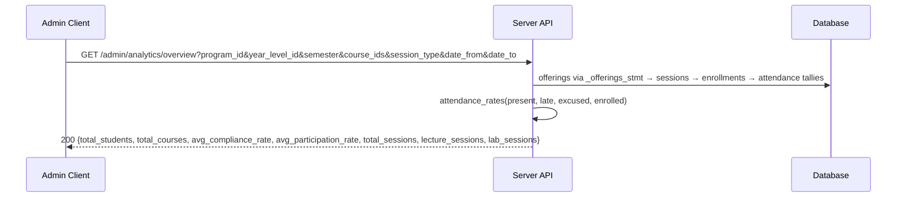

# 08 — End-to-End Workflow

## Overview / comparison / trends



## At-risk

Reads stored risk rows; feature values from JSONB snapshot. Ordered by
`risk_probability` desc.

## Risk refresh

`POST /admin/analytics/refresh-risk` resolves enrollment targets (full batch if
no filters) and recomputes + upserts synchronously; rate-limited 1/60s.

## Staging / promote

Dry-run writes staging rows; promote copies scoped rows into live scores.

## Course options

`GET /admin/analytics/course-options` returns courses with at least one
in-scope offering, supporting search and limit.
```
