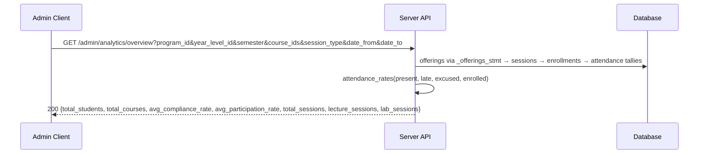

# Analytics — Layered Architecture

Code-grounded technical documentation for the admin analytics and risk-scoring
slice. The codebase is the single source of truth; every claim cites `path:line`.

## Scope

Covers admin analytics (`/admin/analytics/*`): overview, course comparison,
trends, at-risk, course options, risk refresh, risk staging/promote, and the
nightly risk batch. Does not cover attendance scan flow (see
`docs/architecture/attendance-workflow/`) or excuse analytics.

This file consolidates the former layered docs 01–09 in order.

## Layer map

| Layer | Components | Key sources |
|---|---|---|
| Presentation | Admin analytics page, filters, staging/promote UI | `frontend/src/routes/admin/analytics/+page.svelte`, `frontend/src/lib/features/admin/analytics/*` |
| API/Controller | Analytics router, deps, rate limit, error envelopes | `backend/src/features/analytics/router.py`, `backend/src/api/deps.py`, `backend/src/api/router.py` |
| Application | `AnalyticsService`, batch orchestration | `backend/src/features/analytics/service.py`, `backend/src/features/analytics/batch.py` |
| Domain | Rates, cohorts, risk features, decision table, trend slope | `backend/src/shared/rates.py`, `backend/src/shared/cohorts.py`, `backend/src/features/analytics/service.py`, `backend/src/features/analytics/batch.py`, `backend/src/core/config.py` |
| Data | Risk score/staging models, attendance/session/course/enrollment/program models, queries | `backend/src/features/analytics/model.py`, `backend/src/features/*/model.py` |
| Integrations | Nightly cron risk batch, staging/promote, CSV export | `backend/src/core/scheduler.py`, `backend/src/features/analytics/batch.py`, `backend/src/features/analytics/router.py` |

## Related docs

- `docs/architecture/risk-model.md` — detailed risk feature derivations
- `docs/architecture/api-contracts.md` — endpoint contract
- `docs/architecture/data-flow.md` — system-wide flow diagrams
- `docs/architecture/attendance-workflow/` — attendance scan flow and data layer
- `docs/project/decision-log.md` — D34, D35, D85, D86, ADR-084, ADR-085

Last verified against commit: see `git rev-parse HEAD`.

---

# 01 — Architecture Overview

## Layers and boundaries

- **Presentation** — `frontend/src/routes/admin/analytics/+page.svelte`,
  `frontend/src/lib/features/admin/analytics/*`.
- **API/Controller** — `backend/src/features/analytics/router.py` (prefix
  `/admin/analytics`), `backend/src/api/deps.py`, `backend/src/api/router.py`.
- **Application** — `backend/src/features/analytics/service.py`
  (`AnalyticsService`), `backend/src/features/analytics/batch.py`.
- **Domain** — `shared/rates.py::attendance_rates`, `shared/cohorts.py`,
  risk feature computation + heuristic decision table in
  `analytics/batch.py`/`service.py`, trend bucketing `_bucket_key`
  (`analytics/service.py:56`).
- **Data** — `features/analytics/model.py`, plus attendance/session/course/
  enrollment/program models.
- **Integrations** — `core/scheduler.py`, cron risk batch, staging/promote,
  CSV export.

## Dependency direction

- Router depends on `AnalyticsServiceDep`; services only `flush()`.
- All analytics reads derive scope from `_offerings_stmt`
  (`analytics/service.py:68`); course options use the same predicate so the
  picker can never offer a course with no in-scope offering (ADR-085).
- Cohort key is `(course, program, year level)` via `shared/cohorts.py`;
  do not re-key per feature (ADR-084).
- Rates come from `shared/rates.py`; compliance counts `present` only.

## Cross-cutting rules

- Scope filters: program/year/semester/course_ids/session_type/date range.
- `course_ids` honored by overview/comparison/trends/at-risk/staging and
  promote (ADR-085).
- Risk batch runs 02:00 (`RISK_BATCH_CRON`); refresh-risk is synchronous and
  rate-limited 1/60s (`analytics/router.py:193`).
- Dry-run writes to `student_risk_scores_staging`; promote copies to live.

---

# 02 — Presentation Layer

## Admin analytics page

- `frontend/src/routes/admin/analytics/+page.svelte` — filter rail
  (program/year/semester/course/session type/date), tabs: overview,
  comparison, trends, at-risk, staging.
- `frontend/src/lib/features/admin/analytics/service.ts` — API calls.
- `frontend/src/lib/features/admin/analytics/store.svelte.ts` — state.
- `frontend/src/lib/features/admin/analytics/schema.ts` — types.

## Course picker

- Reads `GET /admin/analytics/course-options` (derived from `_offerings_stmt`),
  not the catalogue; supports search `q` and limit.

## Staging / promote UI

- Lists staged dry-run rows (`/risk-staging`), filter unpromoted only;
  promote via `/risk-staging/promote` with optional scope filters.

## Error display

- Admin error envelopes normalized by `client.ts`; analytics errors surface as
  alert banners on the page.

---

# 03 — API and Controller Layer

## Router

`backend/src/features/analytics/router.py` → prefix `/admin/analytics`, guarded
by `require_role(UserRole.ADMIN)` (admin + super_admin).

## Rate limit

- `refresh-risk`: `rate_limit(1, 60)` (`analytics/router.py:193`).

## Endpoint table

| Method | Path | Purpose |
|---|---|---|
| GET | `/admin/analytics/overview` | Totals + avg rates |
| GET | `/admin/analytics/course-comparison` | Cohort rates (paginated) |
| GET | `/admin/analytics/course-options` | Courses with in-scope offerings |
| GET | `/admin/analytics/trends` | Bucketed rates (daily/weekly/monthly) |
| GET | `/admin/analytics/at-risk` | Stored risk rows (paginated) |
| POST | `/admin/analytics/refresh-risk` | Synchronous recalculation |
| GET | `/admin/analytics/risk-staging` | Staged dry-run rows |
| POST | `/admin/analytics/risk-staging/promote` | Promote staged to live |
| POST | `/admin/analytics/export` | CSV course comparison |

---

# 04 — Application and Service Layer

## AnalyticsService

`backend/src/features/analytics/service.py` (`AnalyticsService`). Methods:

- `get_overview(...)` — totals + avg compliance/participation rates.
- `get_course_comparison(...)` — one row per cohort (course × program × year
  level), paginated.
- `list_course_options(...)` — distinct courses with at least one in-scope
  offering.
- `get_trends(...)` — rates bucketed by day/week/month.
- `get_at_risk(...)` — stored risk rows, ordered by probability desc.
- `refresh_risk(...)` — synchronous scoped recalculation.
- `list_staged(...)` / `promote_staged(...)` — dry-run staging review/promote.
- `export_course_comparison(...)` — CSV.

## Batch orchestration

- `features/analytics/batch.py::run_risk_batch(session, targets)` computes
  features and upserts risk rows; used by both cron and refresh.
- Risk batch cron 02:00 (`RISK_BATCH_CRON`); workers sharded via
  `RISK_BATCH_WORKERS`.

## Transactions

Services only `flush()`; `_get_db` commits/rolls back.

---

# 05 — Domain and Business Logic Layer

## Rates

`shared/rates.py::attendance_rates(present, late, excused, enrolled)` →
`(compliance, participation)`, keyword-only, 4-decimal rounding,
`(0.0, 0.0)` for non-positive denominator. Compliance = present/enrolled;
participation = (present+late+excused)/enrolled.

## Cohorts

`shared/cohorts.py::cohort_key(offering)` = `(course_id, program_id,
year_level_id)`. `group_by_cohort` groups offerings by cohort
(ADR-084). Semester and dates are filter axes, not identity.

## Risk features

Per `(student, offering, semester)` (see `docs/architecture/risk-model.md`):
expected sessions, absence rate, max consecutive streak, sync lag, 4-week trend
slope. Heuristic decision table (first match wins): absence_rate > 0.30 → high;
streak ≥ 3 → high; absence_rate > 0.15 → medium; sync_lag ≥ 5 → medium;
trend_slope < -0.05 → medium; else low.

## Trend bucketing

`_bucket_key` (`analytics/service.py:56`): daily → day; weekly → Monday (date
from ordinal minus weekday); monthly → first day of month.

## Course options

Derived from `_offerings_stmt` (`analytics/service.py:68`), so the picker only
offers courses with at least one in-scope offering (ADR-085).

---

# 06 — Data Access and Persistence Layer

## Models

- `features/analytics/model.py::StudentRiskScore` → `student_risk_scores`
  (student_id, offering_id, semester, risk_probability, risk_level, features
  JSONB, computed_at, computed_day). UNIQUE(student_id, offering_id, semester,
  computed_day).
- `features/analytics/model.py::StudentRiskScoreStaging` →
  `student_risk_scores_staging` (same shape + promoted_at).
- Reads join `Student`, `Program`, `YearLevel`, `CourseOffering`, `Course`,
  `Enrollment`, `Session`, `Attendance`.

## Queries

- Overview/course comparison: offerings via `_offerings_stmt`, sessions via
  `_scoped_sessions`, enrollments via `_enrollments_by_offering`, tallies via
  `_tallies_for_sessions`.
- At-risk: joins risk score → student → year level → program → offering →
  course, filtered by scope, ordered by probability desc
  (`analytics/service.py:551`).
- Staging: same shape as at-risk, plus `promoted_at` filter.

## SQLite shims
Same as attendance: JSONB→JSON, BigInteger→INTEGER, aware-UTC DateTime,
`PRAGMA foreign_keys=ON`.

---

# 07 — Integrations and Background Processing

## Nightly risk batch

- `core/scheduler.py` owns APScheduler; job body
  `analytics/batch.py::run_scheduled_risk_batch` (02:00, `RISK_BATCH_CRON`),
  commits its own transaction.
- `RISK_BATCH_WORKERS` shards scoring; `RISK_BATCH_CHUNK_SIZE` batches.
- `RISK_BATCH_DRY_RUN` writes staging instead of live scores.

## Staging and promote

- `risk-staging` lists dry-run rows; `risk-staging/promote` copies staged
  rows into live scores, scoped by student/offering/semester/program/year/
  course (ADR-085).

## CSV export

- `POST /admin/analytics/export` renders course comparison as CSV
  (`EXPORT_FILENAME = "analytics-course-comparison.csv"`).

## Email
Not used by analytics; see `shared/email.py` for the single delivery path.

---

# 08 — End-to-End Workflow

## Overview / comparison / trends



## At-risk

Reads stored risk rows; feature values from JSONB snapshot. Ordered by
`risk_probability` desc.

## Risk refresh

`POST /admin/analytics/refresh-risk` resolves enrollment targets (full batch if
no filters) and recomputes + upserts synchronously; rate-limited 1/60s.

## Staging / promote

Dry-run writes staging rows; promote copies scoped rows into live scores.

## Course options

`GET /admin/analytics/course-options` returns courses with at least one
in-scope offering, supporting search and limit.
```

---

# 09 — Dependencies and Data Flow

## Dependency graph (simplified)

```
admin analytics page ──► analytics/service.ts ──► /admin/analytics/*
                                                    │
                                                    ▼
                                           analytics/router.py
                                                    │
                                                    ▼
                                           AnalyticsService
                                             ├─ _offerings_stmt (course/model)
                                             ├─ _scoped_sessions (session/model)
                                             ├─ _enrollments_by_offering (enrollment/model)
                                             ├─ _tallies_for_sessions (attendance/model)
                                             ├─ attendance_rates (shared/rates)
                                             ├─ group_by_cohort (shared/cohorts)
                                             ├─ run_risk_batch (analytics/batch)
                                             └─ StudentRiskScore / Staging (analytics/model)
```

## Transformations

- Scope filters → offering ids → sessions → enrollments → attendance tallies →
  rates (compliance/participation).
- Trends bucket by `_bucket_key` on `created_at`/`timestamp`.
- Risk features → heuristic decision table → risk level + synthetic probability.

## Error paths

- 422 `validation_error` (semester required with offering_id on refresh).
- 403 admin guard (`require_role(UserRole.ADMIN)`).
- 429 rate limit on refresh-risk (1/60s).
- Empty scope returns empty items, not errors.

---

# 10 — Result Calculation Methodology

Risk feature derivations are detailed in `docs/architecture/risk-model.md`; this
section summarizes service-level calculation and persistence behavior.

## 10.1 Common scope resolution

- Offerings: `_offerings_stmt(program_id, year_level_id, semester, course_ids)`
  filters `CourseOffering` by program, year level, semester, and course ids. It
  does not apply an `is_active` gate.
- Sessions: `_scoped_sessions` filters by offering ids, `Session.created_at`
  range (`date_from`/`date_to`), and optional `session_type`.
- Enrollments: `_enrollments_by_offering` groups `Enrollment.student_id` by
  offering.
- Tallies: `_tallies_for_sessions` counts `Attendance.validation_status`.
- Expected incidences: `_expected_for` sums `len(enrolled students)` for each
  session's offering. This is session-student incidences, not unique students.

## 10.2 Overview

- `total_students`: unique students across all scoped offerings.
- `total_courses`: distinct `course_id` among scoped offerings.
- `total_sessions`: number of scoped sessions.
- `lecture_sessions` / `lab_sessions`: counts by `session_type`.
- `enrolled`: expected incidences from `_expected_for`.
- `compliance_rate`, `participation_rate`: `attendance_rates(present, late,
  excused, enrolled)`:
  - compliance = `present / enrolled`
  - participation = `(present + late + excused) / enrolled`
  - rounded to 4 decimals; both are `0.0` when `enrolled <= 0`.
- `SessionActiveResponse.compliance_rate` / `participation_rate` (`GET /professor/sessions/active/{session_id}`) reuse the same `shared/rates.py::attendance_rates` helper.

## 10.3 Course comparison

- Group scoped offerings by cohort key `(course_id, program_id,
  year_level_id)`.
- For each cohort, aggregate sessions across all offerings in that cohort,
  then compute enrollments, tallies, expected incidences, and rates.
- `total_sessions` is the number of sessions in that cohort.
- Sort by course code, then program id, then year level id.
- Paginate after grouping: `total` is the cohort count, not offering count.

## 10.4 Trends

- Session buckets use `Session.created_at` with `_bucket_key`:
  - daily: calendar day
  - weekly: Monday of that week
  - monthly: first day of the month
- Attendance tallies are bucketed by `Attendance.timestamp` (scan time), not
  by the session's created time.
- `enrolled` for a bucket is the sum of enrolled counts for sessions whose
  `created_at` falls in that bucket.
- Rates are computed per bucket using the bucket tallies and bucket enrolled
  count.
- `total_sessions` is the distinct sessions whose `created_at` falls in that
  bucket.
- Result buckets are the union of session buckets and attendance buckets.
- Paginate after bucketing.

## 10.5 At-risk list

- Reads stored `StudentRiskScore` rows; it does not recalculate risk.
- Joins student, program, year level, offering, and course.
- Filters by program, year level, score semester, course ids, and risk level.
- Orders by `risk_probability` desc, then `computed_at` desc, then id desc.
- Feature values come from the stored JSONB snapshot.

## 10.6 Risk score calculation

- Targets:
  - no filters: all active enrollments (`CourseOffering.is_active = true`)
  - `offering_id` requires `semester`
  - `student_id` filters by student
  - `semester` alone filters enrollments by semester
  - `student_id` plus `semester` ignores semester by design
- Expected sessions:
  - `term_weeks(year_level.term_structure, semester) *
    offering.sessions_per_week`
  - missing/invalid term structure defaults to 18 weeks
  - if expected sessions is `<= 0`, `absence_rate` is `0.0`
- Usable records exclude `rejected` attendance rows.
- Features:
  - `absence_rate = absent_count / expected_sessions`
  - `max_streak` = longest consecutive `absent` run in chronological order;
    `pending` does not break the streak; `present`, `late`, and `excused`
    reset it
  - `sync_lag` = pending-sync records older than 24 hours
  - `weekly_absences` = absent counts over the last four Monday-Sunday weeks,
    oldest first; older absences are omitted and future absences fall in the
    current week
  - `trend_slope` = linear regression slope of the four weekly absence counts
    over x = 1, 2, 3, 4
- Risk level is first-match:
  - `absence_rate > 0.30` -> high
  - `max_streak >= 3` -> high
  - `absence_rate > 0.15` -> medium
  - `sync_lag >= 5` -> medium
  - `trend_slope < -0.05` -> medium
  - otherwise low
- Risk probability:
  - `0.40 * min(absence_rate / 0.30, 1.0)`
  - `+ 0.25 * min(max_streak / 3, 1.0)`
  - `+ 0.15 * min(sync_lag / 5, 1.0)`
  - `+ 0.20 * min(max(trend_slope, 0) / 0.10, 1.0)`
  - clamped to `[0.0, 1.0]` and rounded to 4 decimals
- Persistence:
  - batch and refresh both upsert by
    `(student_id, offering_id, semester, computed_day)`
  - `computed_day` is the UTC date of the run
  - dry run writes `student_risk_scores_staging`
  - promote copies unpromoted staged rows to live scores by the same key and
    stamps `promoted_at`

## 10.7 Course options

- Returns distinct courses that have at least one offering in the selected
  scope.
- Scope uses the same `_offerings_stmt` predicate as report reads.
- Optional search matches course code or course name.
- No `is_active` gate, so archived offerings with history remain reachable.

## 10.8 Staging and promote

- `risk-staging` lists staged rows with the same joins and filters as at-risk.
- `unpromoted_only` filters to rows where `promoted_at IS NULL`.
- Promote copies all matching unpromoted staged rows into live scores.
- Existing live rows with the same
  `(student_id, offering_id, semester, computed_day)` are updated.
- Promoted staged rows receive `promoted_at`.

## 10.9 Edge cases

- No scoped offerings: overview and comparison return empty; trends returns
  empty; course options returns empty.
- `enrolled <= 0`: both rates are `0.0`.
- `expected_sessions <= 0`: `absence_rate` is `0.0`.
- Rejected attendance rows are excluded from risk records, but overview and
  comparison tallies only use present/late/excused in their numerators.
- Refresh with `offering_id` requires `semester`.
- Semester is ignored when both `student_id` and `semester` are supplied.


---

# 11 — Admin Attendance Analytics (`/admin/attendance/*`)

Separate from the analytics rail above; provides per-course and per-record
attendance reporting for administrators. Backed by `AttendanceService` in
`backend/src/features/attendance/service.py` and `attendance/admin_router.py`.

## Endpoints

| Method | Path | Purpose |
|---|---|---|
| GET | `/admin/attendance/overview` | Per-course sessions, compliance rate, trend + status counts |
| GET | `/admin/attendance/overview/export` | CSV of the overview |
| GET | `/admin/attendance/summary` | Aggregate KPIs (records, present/late/excused/rejected, rates, totals, previous-period rates) |
| GET | `/admin/attendance/records` | Paginated detailed records (student, course, program, year, instructor, session, status, scanned_at) |
| GET | `/admin/attendance/records/export` | CSV of filtered records |
| GET | `/admin/attendance/recent-scans` | Latest scans feed |

## Filters (overview / summary / records)

`program_id`, `year_level_id`, `semester`, `course_id`, `professor_id`,
`session_type` (lecture/lab), `date_from`, `date_to`. Records additionally
support `status`, `student_search`, `page`, `size`, `sort_by`, `sort_dir`.
`status` is not accepted by `/overview` (aggregate semantics).

## Notes

- Compliance = present/enrolled; participation = (present+late+excused)/enrolled
  via `shared/rates.py::attendance_rates`.
- Overview trend is a half-split (first half vs second half compliance).
- Instructor name is resolved from the offering's current `CourseProfessor`
  assignment.
- Records are paginated (max page size `MAX_PAGE_SIZE`); aggregates computed at
  DB level.
