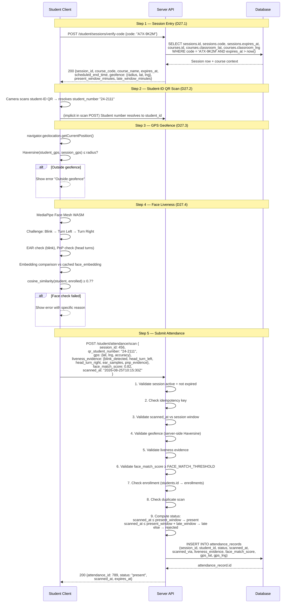
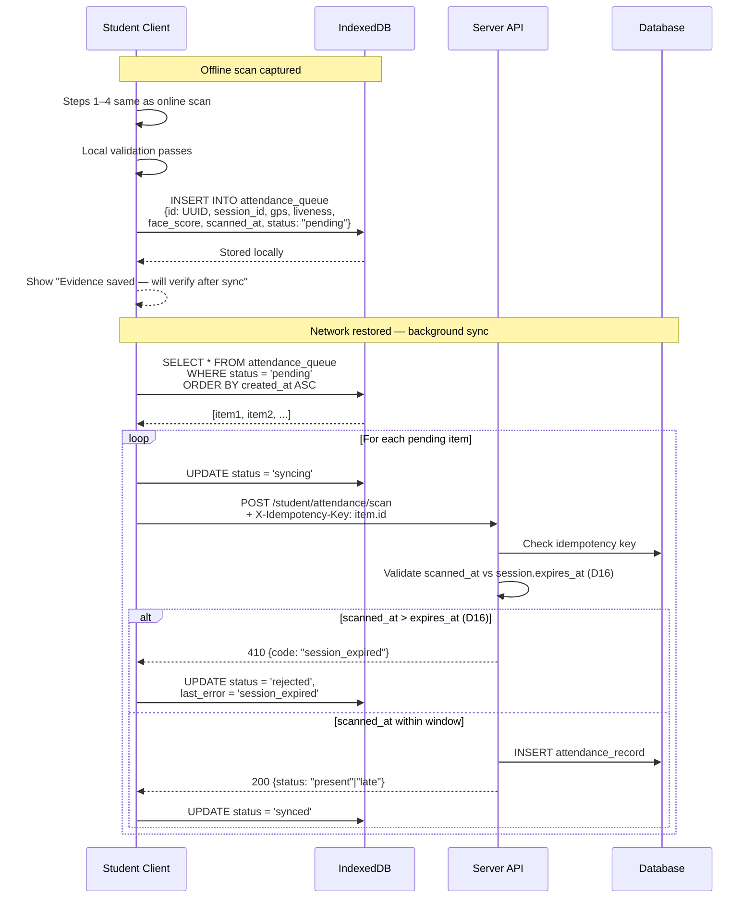
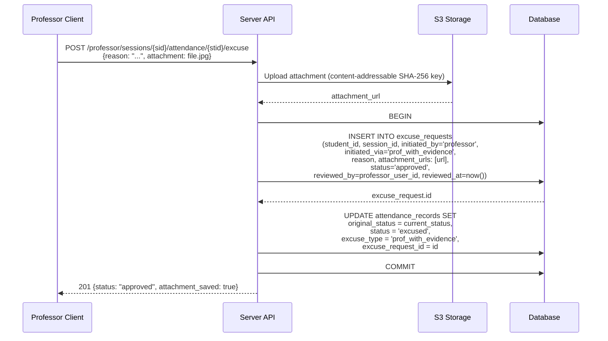
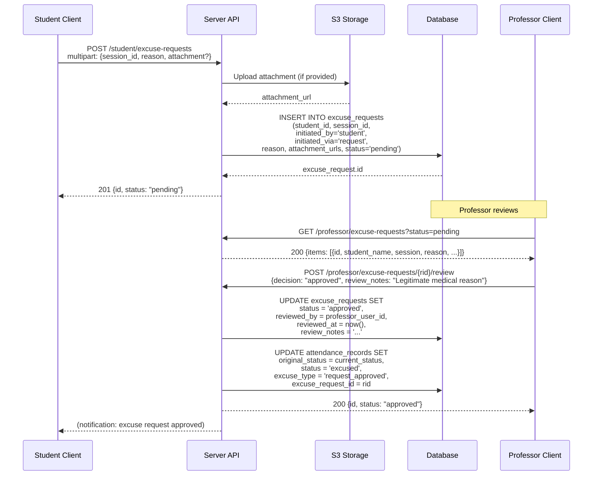
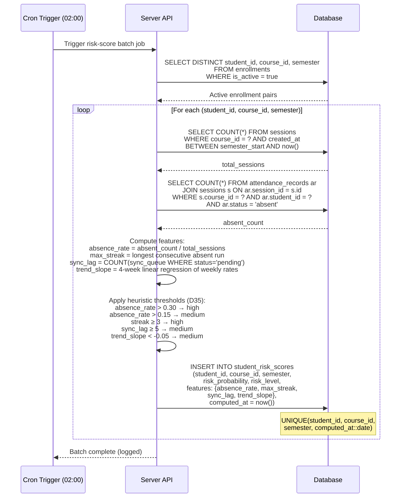
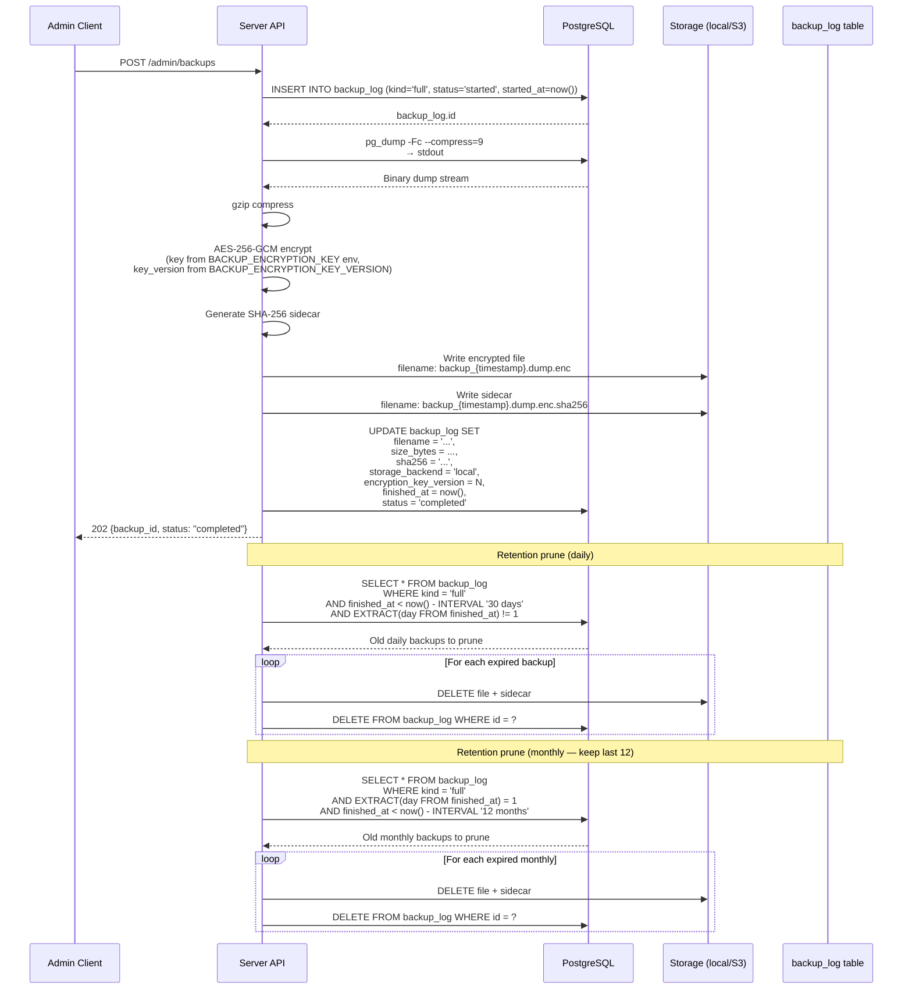

# Data Flow Diagrams

> Mermaid sequence diagrams for all major system flows. References §6 table
> and column names from DOCS_REFACTOR_PLAN.md.

---

## 1. Full Online Scan (D27)

---

## 2. Offline Scan → Sync

---

## 3. Excuse Workflow (D20–D24)

### Path A: Professor Quick-Excuse

### Path B: Professor-Initiated with Evidence

### Path C: Student-Initiated Request

---

## 4. Nightly Risk Batch (D35)

---

## 5. Backup Pipeline (D39)

---

## Appendix: Table/Column Reference (§6)

All diagrams above reference the target schema in §6:

| Diagram      | Tables Referenced                                                                    |
| ------------ | ------------------------------------------------------------------------------------ |
| Online Scan  | `sessions`, `courses`, `enrollments`, `attendance_records`, `students`               |
| Offline Sync | `attendance_records`, `sync_queue` (client-side `attendance_queue`)                  |
| Excuse       | `excuse_requests`, `attendance_records`, `users` (excused_by, reviewed_by)           |
| Risk Batch   | `enrollments`, `sessions`, `attendance_records`, `student_risk_scores`, `sync_queue` |
| Backup       | `backup_log`, all tables via `pg_dump`                                               |
