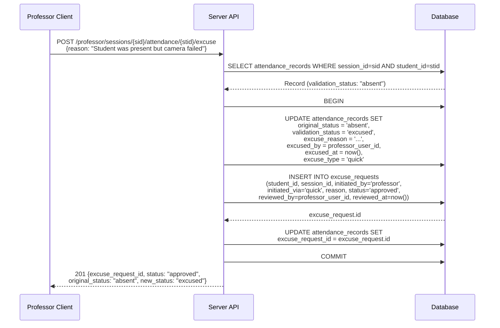
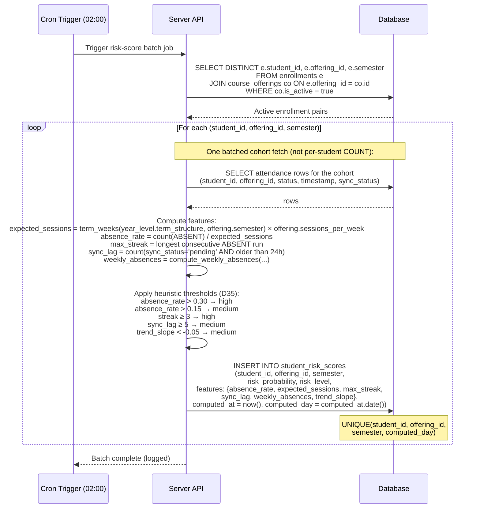
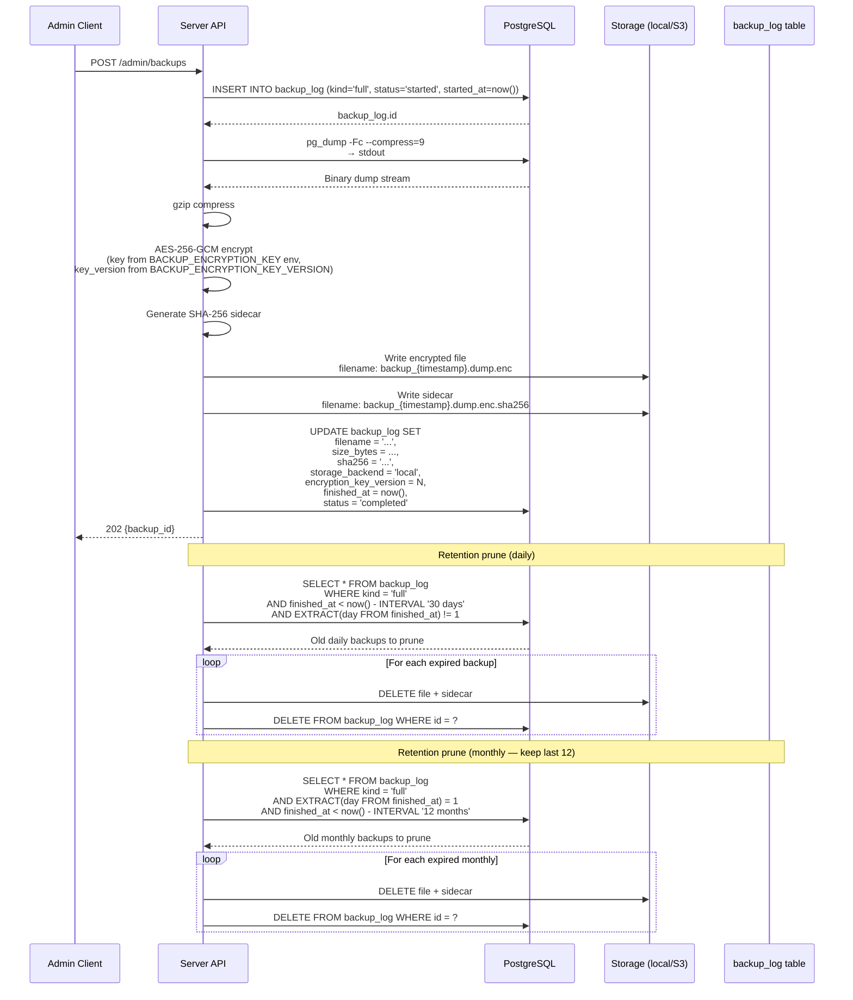

# Data Flow Diagrams

> Layered, code-grounded attendance workflow docs:
> [`docs/architecture/attendance-workflow/`](attendance-workflow/README.md). This file keeps
> the system-wide sequence diagrams; that directory holds the per-layer audit.
> Analytics layer docs: [`docs/architecture/analytics.md`](analytics.md).
> Anti-spoofing layer docs: [`docs/architecture/anti-spoofing.md`](anti-spoofing.md).

> Mermaid sequence diagrams for all major system flows. References the
> [target schema](../design/database-er.md) and its column names.

---

## 1. Full Online Scan (D27, amended by ADR-083)

```mermaid
sequenceDiagram
    participant S as Student Client
    participant API as Server API
    participant DB as Database

    Note over S,DB: Step 0 — Authenticated Identity (ADR-083)

    S->>API: POST /auth/login
    API-->>S: 200 {access_token, ...} (student role)

    Note over S,DB: Step 1 — Session Entry (D27.1)

    S->>API: POST /student/sessions/verify-code {code: "A7X9K2M4"}
    API->>DB: SELECT sessions.id, sessions.session_code, sessions.expires_at,<br>course_offerings.id, course_offerings.classroom_lat, course_offerings.classroom_lng<br>WHERE session_code = 'A7X9K2M4' AND expires_at > now()
    DB-->>API: Session row + offering context
    API-->>S: 200 {session_id, offering_id, session_type, is_remote, course_code, course_name, program_code, year_level_label,<br>expires_at, scheduled_end_time, classroom_name, geofence: {radius, lat, lng},<br>present_window_minutes, late_window_minutes}

    Note over S,DB: Step 2 — Student-ID Confirmation (D27.2 as amended)

    S->>S: Prefill student number from the signed-in profile
    S->>API: POST /student/attendance/precheck {session_id, student_number}
    API->>API: Resolve Student WHERE Student.user_id = token user_id
    API->>API: Compare student_number case-insensitively → 403 student_number_mismatch on mismatch
    API->>DB: Check enrollment + duplicate scan
    API-->>S: 200 {enrolled, already_scanned, student}

    Note over S,DB: Step 3 — Session QR Camera (current UI)

    S->>S: QRScanner reads the session code
    S->>API: POST /student/sessions/verify-code {code}
    Note right of S: Session discovery only — it never reads a student ID.<br>The professor UI currently shows the session code, not a rendered QR.

    Note over S,DB: Step 4 — GPS + Face Liveness (D27.3–D27.4)

    S->>S: MediaPipe FaceLandmarker WASM
    S->>S: Challenge: Blink → Turn Left → Turn Right
    S->>S: EAR check (blink), PnP check (head turns)
    S->>S: Capture scan frame (live_face_image) — server computes embedding (MobileFaceNet) and score
    S->>S: navigator.geolocation.getCurrentPosition() + Haversine pre-check
    alt Outside geofence
        S-->>S: Show error "Outside geofence"
    end

    Note over S,DB: Step 5 — Submit Attendance

    S->>API: POST /student/attendance/scan {<br>session_id: 456,<br>student_number: "24-2111",<br>gps: {lat, lng, accuracy},<br>liveness_evidence: {blink_detected, head_turn_left,<br>head_turn_right, ear_samples, pnp_evidence},<br>live_face_image: "<base64 scan frame>",<br>scanned_at: "2026-08-25T10:15:30Z"<br>}

    API->>API: 1. Check idempotency key → return prior result<br>(key = "user_id:session_id:X-Idempotency-Key", 15-min TTL)
    API->>API: 2. Verify session exists & is active + not expired
    API->>API: 3. Resolve student by token user_id; compare student_number
    API->>API: 4. Check enrollment (students.id → enrollments)
<    API->>API: 5. Check face enrollment (students.face_embedding NOT NULL) → 403 face_not_enrolled
    API->>API: 6. Check duplicate scan
    API->>API: 7. Validate geofence (server-side Haversine) — only when benchmark_mode is off
    API->>API: 8. Validate liveness evidence — only when benchmark_mode is off
    API->>API: 9. Generate embedding from live_face_image (MobileFaceNet) or live_face_embedding; cosine_similarity vs enrolled; score band: < 0.65 → 403 face_mismatch; 0.65–0.70 → pending review

    API->>API: 10. Compute status (elapsed since max(session.created_at, session.scheduled_start_time)):<br>elapsed ≤ present_window → present<br>elapsed ≤ present_window + late_window → late<br>else → rejected

    API->>DB: INSERT INTO attendance_records<br>(session_id, student_id, validation_status, timestamp,<br>scanned_via, liveness_evidence, face_match_score,<br>gps_lat, gps_lng, original_status, sync_status)
    DB-->>API: attendance_records.id

    API-->>S: 200 {id: 789, status: "present",<br>scanned_at, expires_at}
```

> **Identity note:** `student_number` is a confirmation check only. The student
> row is selected by `Student.user_id`, so a client cannot submit as somebody
> else. `face_match_score` is computed server-side from the enrolled embedding
> and the embedding generated from `live_face_image` (MobileFaceNet, cosine
> similarity); the client supplies the image, not a score (threshold 0.70,
> review band 0.65). See `shared/face_embeddings.py` and
> `shared/face_embedding_generator.py`.

---

## 2. Offline Scan → Sync

```mermaid
sequenceDiagram
    participant S as Student Client
    participant IDB as IndexedDB
    participant API as Server API
    participant DB as Database

    Note over S,IDB: Offline scan captured

    S->>S: Steps 1–4 same as online scan (session code, ID confirmation, liveness, GPS)
    S->>S: Local validation passes
    S->>IDB: INSERT INTO attendance_queue<br>{id: UUID, session_id, session_code, student_number,<br>payload: {gps, liveness_evidence, scanned_at},<br>status: "pending" (client queue state), attempts: 0}
    IDB-->>S: Stored locally
    S-->>S: Show "Evidence saved — will verify after sync"

    Note over S,IDB: `student_number` is queued for the confirmation check only;<br>the server re-resolves the student from the sync token.<br>The replay path supplies the same placeholder `face_match_score`.

    Note over S,DB: Network restored — background sync

    S->>IDB: SELECT * FROM attendance_queue<br>WHERE status = 'pending' (client queue state)<br>ORDER BY created_at ASC
    IDB-->>S: [item1, item2, ...]

    loop For each pending item
        S->>IDB: UPDATE status = 'syncing' (client queue state)
        S->>API: POST /student/attendance/scan<br>+ X-Idempotency-Key: user_id:session_id:item.id
        API->>DB: Check idempotency key (user_id:session_id:key, 15-min TTL)
        API->>API: Validate elapsed vs session window (D16)

        alt scanned_at > expires_at (D16)
            API-->>S: 410 {detail: {code: "session_expired", message: "Scan submitted after window closed"}}
            S->>IDB: UPDATE status = 'rejected' (client queue state),<br>last_error = 'session_expired'
        else scanned_at within window
            API->>DB: INSERT attendance_records
            API-->>S: 200 {status: "present"|"late"}
            S->>IDB: UPDATE status = 'synced' (client queue state)
        end
    end
```

> **Client vs DB statuses:** `pending`/`syncing`/`synced`/`rejected` above are
> **client-local queue states** on the `attendance_queue` IndexedDB store — NOT
> server enums. The DB uses `SyncStatus` (`synced`/`pending`/`failed`) on
> `attendance_records.sync_status` and `QueueStatus`
> (`pending`/`processing`/`done`/`failed`) on the `sync_queue` table.

---

## 3. Excuse Workflow (D20–D24)

### Path A: Professor Quick-Excuse



### Path B: Professor-Initiated with Evidence

```mermaid
sequenceDiagram
    participant P as Professor Client
    participant API as Server API
    participant S3 as S3 Storage
    participant DB as Database

    P->>API: POST /professor/sessions/{sid}/attendance/{stid}/excuse<br>{reason: "...", attachment_urls: [url]}
    Note over API,S3: bytes went up earlier via
    POST /upload/presigned-url → client PUT to storage;
    the server never brokers the file itself
    API->>DB: BEGIN
    API->>DB: INSERT INTO excuse_requests<br>(student_id, session_id, initiated_by='professor',<br>initiated_via='prof_with_evidence',<br>reason, attachment_urls: [url],<br>status='approved',<br>reviewed_by=professor_user_id, reviewed_at=now())
    DB-->>API: excuse_request.id
    API->>DB: UPDATE attendance_records SET<br>original_status = current_status,<br>validation_status = 'excused',<br>excuse_type = 'prof_with_evidence',<br>excuse_request_id = id
    API->>DB: COMMIT

    API-->>P: 201 {status: "approved", attachment_saved: true}
```

### Path C: Student-Initiated Request

```mermaid
sequenceDiagram
    participant ST as Student Client
    participant API as Server API
    participant S3 as S3 Storage
    participant DB as Database
    participant P as Professor Client

    ST->>API: POST /student/excuse-requests<br>{session_id, reason, attachment_urls?}
    Note over API,S3: presigned upload (POST /upload/presigned-url)
    completed client-side before this; server stores URL references
    API->>DB: INSERT INTO excuse_requests<br>(student_id, session_id,<br>initiated_by='student',<br>initiated_via='request',<br>reason, attachment_urls, status='pending')
    DB-->>API: excuse_request.id
    API-->>ST: 201 {id, status: "pending"}

    Note over P,DB: Professor reviews

    P->>API: GET /professor/excuse-requests?status=pending
    API-->>P: 200 {items: [{id, student_name, session, reason, ...}]}

    P->>API: POST /professor/excuse-requests/{rid}/review<br>{status: "approved", review_notes: "Legitimate medical reason"}
    API->>DB: UPDATE excuse_requests SET<br>status = 'approved',<br>reviewed_by = professor_user_id,<br>reviewed_at = now(),<br>review_notes = '...'
    API->>DB: UPDATE attendance_records SET<br>original_status = current_status,<br>validation_status = 'excused',<br>excuse_type = 'request_approved',<br>-- (request_approved is a valid attendance_records.excuse_type;<br>-- differs from excuse_requests.initiated_via = 'request')<br>excuse_request_id = rid
    API-->>P: 200 {id, status: "approved"}

    API-->>ST: (notification: excuse request approved)
```

---

## 4. Nightly Risk Batch (D35)



---

## 5. Backup Pipeline (D39)



---

## Appendix: Table/Column Reference

All diagrams above reference the target schema in
[`../design/database-er.md`](../design/database-er.md):

| Diagram      | Tables Referenced                                                                    |
| ------------ | ------------------------------------------------------------------------------------ |
| Online Scan  | `sessions`, `course_offerings`, `enrollments`, `attendance_records`, `students`    |
| Offline Sync | `attendance_records` (client persists to IndexedDB `attendance_queue`)        |
| Excuse       | `excuse_requests` (reviewed_by), `attendance_records` (excused_by)                    |
| Risk Batch   | `enrollments`, `sessions`, `attendance_records`, `student_risk_scores` (reads `attendance_records.sync_status`) |
| Backup       | `backup_log`, all tables via `pg_dump`                                               |
