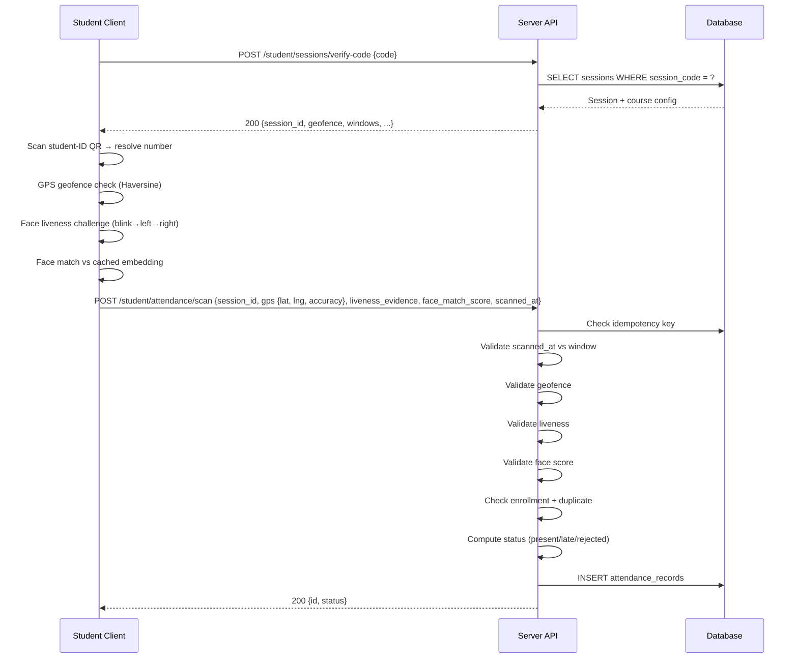
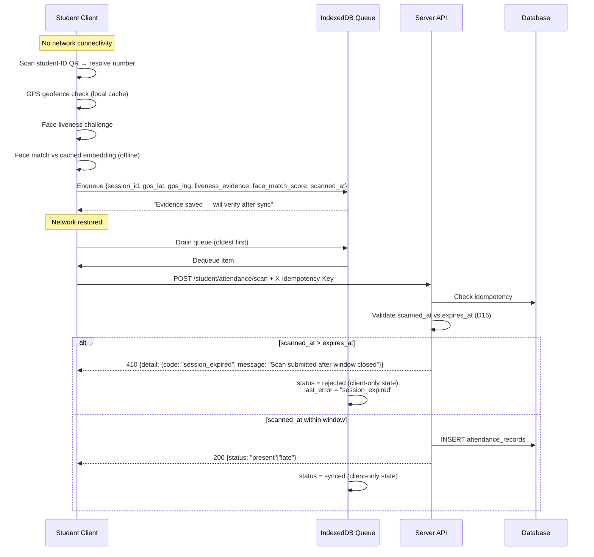
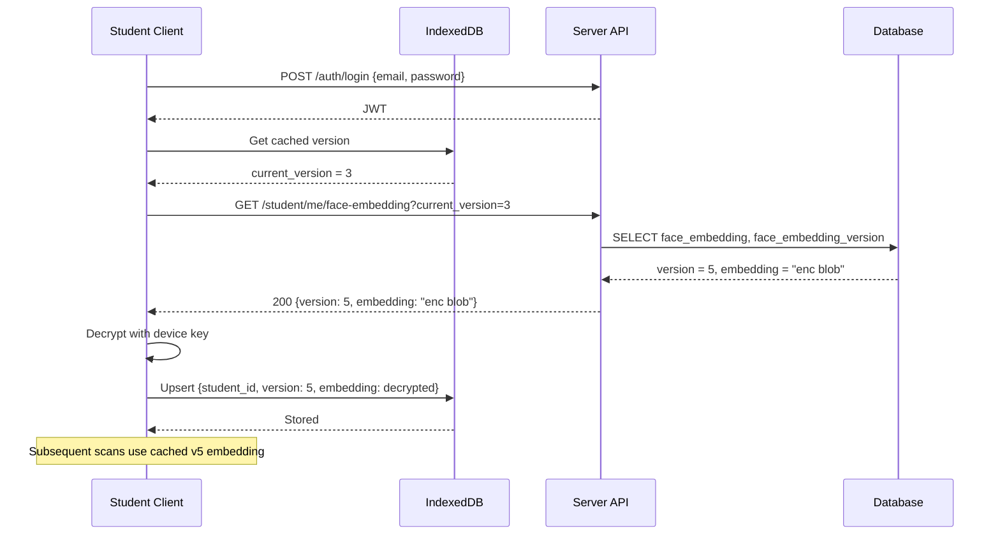

# Offline-First Architecture

> Client-side offline storage, sync algorithm, and server-side validation for
> scans that occur without network connectivity.

---

## Overview

The student scanner must work reliably in lecture halls with poor connectivity.
All scan data is captured client-side first; network is optional. On connectivity
restoration, the sync queue drains to the server, which validates timestamps
and rejects expired-window submissions.

---

## IndexedDB Stores

All client storage uses IndexedDB via a thin wrapper (e.g., `idb` library).
Three object stores:

### 1. `attendance_queue`

Stores pending scan submissions.

| Column              | Type     | Notes                                                        |
| ------------------- | -------- | ------------------------------------------------------------ |
| `id`                | UUID     | Auto-generated client ID                                     |
| `session_id`        | int      | FK to server session                                         |
| `session_code`      | string   | For display/debug                                            |
| `student_number`  | string   | Student number from ID QR                                    |
| `gps_lat`           | float    | Captured at scan time                                        |
| `gps_lng`           | float    | Captured at scan time                                        |
| `gps_accuracy`      | float    | metres                                                       |
| `liveness_evidence` | JSON     | blink, head turns, EAR, PnP                                  |
| `face_match_score`  | float    | Cosine similarity                                            |
| `scanned_at`        | ISO-8601 | **Device timestamp at scan** (validated server-side per D16) |
| `status`            | enum     | `pending` → `syncing` → `synced` / `rejected` — **client-local queue states** (NOT DB enums; server uses `SyncStatus` = `synced`/`pending`/`failed` and `QueueStatus` = `pending`/`processing`/`done`/`failed`) |
| `retry_count`       | int      | Exponential backoff counter                                  |
| `last_error`        | string   | Server rejection reason, if any                              |
| `created_at`        | ISO-8601 | Local enqueue time                                           |

### 2. `face_embeddings`

Cached face embeddings, encrypted at rest via WebCrypto (AES-GCM) with a device-unique key.

| Column       | Type        | Notes                     |
| ------------ | ----------- | ------------------------- |
| `student_id` | int         | Own embedding             |
| `version`    | int         | Server embedding version  |
| `embedding`  | ArrayBuffer | Encrypted 128-d vector(s) |
| `fetched_at` | ISO-8601    | Cache freshness           |

### 3. `session_cache`

Read-only snapshots of active session config (for offline display and GPS checks).

| Column                   | Type     | Notes                  |
| ------------------------ | -------- | ---------------------- |
| `session_id`             | int      |                        |
| `course_code`            | string   |                        |
| `geofence`               | JSON     | `{ radius, lat, lng }` |
| `expires_at`             | ISO-8601 | For local expiry check |
| `present_window_minutes` | int      |                        |
| `late_window_minutes`    | int      |                        |

---

## Sync Algorithm

```
┌─────────────────────────────────────────────────────┐
│                   Client Side                        │
│                                                      │
│  1. Online scan happy path:                          │
│     scan → validate locally → POST /student/attendance/scan  │
│     → server responds → update queue (synced)        │
│                                                      │
│  2. Offline scan path:                               │
│     scan → validate locally → enqueue to             │
│     attendance_queue (status: pending)               │
│     → user sees "queued for sync" badge              │
│                                                      │
│  3. Background sync trigger:                         │
│     a. `navigator.onLine` change event               │
│     b. Periodic retry (exponential backoff)          │
│     c. Service Worker `sync` event (if available)    │
│                                                      │
│  4. Drain queue:                                     │
│     for each item (oldest first):                    │
│       set status = syncing (client-only state)       │
│       POST /student/attendance/scan with X-Idempotency-Key   │
│       = item.id                                      │
│       → 200: set status = synced (client-only state) │
│       → 4xx reject: set status = rejected,           │
│         last_error = server message                  │
│       → network error: revert status = pending,      │
│         increment retry_count, schedule next          │
│                                                      │
└─────────────────────────────────────────────────────┘

┌─────────────────────────────────────────────────────┐
│                   Server Side                        │
│                                                      │
│  POST /student/attendance/scan:                              │
│    1. Verify session exists & is active              │
│    2. Validate scanned_at against session window:    │
│       - If scanned_at > session.expires_at:          │
│         REJECT → { code: "session_expired",          │
│           message: "Scan submitted after window      │
│           closed" } (D16)                            │
│    3. Check idempotency key → return prior result    │
│    4. Validate geofence (Haversine)                  │
│    5. Validate liveness evidence                     │
│    6. Validate face_match_score ≥ threshold          │
│    7. Check enrollment                               │
│    8. Check duplicate scan                           │
│    9. Compute status:                                │
│       scanned_at ≤ present_window → present          │
│       scanned_at ≤ present_window + late_window      │
│                                        → late        │
│       else → rejected (late after window)            │
│    10. Write attendance_records                       │
│    11. Return result                                 │
│                                                      │
└─────────────────────────────────────────────────────┘
```

### Rejection Reasons

| Reason             | When                                | Decision   |
| ------------------ | ----------------------------------- | ---------- |
| `session_expired`  | `scanned_at` after `expires_at`     | D16        |
| `outside_geofence` | GPS outside radius                  | D27 step 3 |
| `liveness_failed`  | Liveness checks fail                | D31        |
| `face_mismatch`    | Cosine similarity < threshold       | D27 step 4 |
| `not_enrolled`     | Student not in course roster        | D27 step 2 |
| `duplicate`        | Student already scanned for session | D27 step 2 |

### Exponential Backoff

```
retry_delay = min(30s * 2^retry_count, 30 minutes)
```

- First retry: 30s
- Second: 60s
- Third: 120s
- Max: 30 minutes
- Reset `retry_count` to 0 on successful sync

### Conflict Resolution

No client-side conflict possible — the server is the sole authority for
attendance records. Clients submit; server decides. If rejected, the queue
item stays in `rejected` state with `last_error` for user visibility.

---

## Embedding Pull-On-Login (D29)

```
┌──────────┐         ┌──────────┐
│  Student  │         │  Server  │
│  Client   │         │   API    │
└─────┬────┘         └─────┬────┘
      │                    │
      │  1. Login          │
      │───────────────────►│
      │  2. JWT            │
      │◄───────────────────│
      │                    │
      │  3. GET /student/  │
      │     me/face-       │
      │     embedding      │
      │     ?current_      │
      │     version=N      │
      │───────────────────►│
      │                    │
      │  4a. 204 No Content│  (version matches)
      │◄───────────────────│
      │                    │
      │  OR                │
      │                    │
      │  4b. 200 {version, │  (newer version)
      │     encrypted_blob}│
      │◄───────────────────│
      │                    │
      │  5. Decrypt with   │
      │     device key,    │
      │     store in       │
      │     IndexedDB      │
      │                    │
```

**Device encryption key**: generated once per device via `crypto.subtle.generateKey`,
stored in `crypto.subtle` (non-extractable) or in a secure enclave. The server
never sees this key.

**Re-enrollment**: When admin re-enrolls a student (3 new photos), `face_embedding_version`
increments. Next student login triggers pull. Old cached embedding is superseded.

**Revocation**: If student account is archived, the server returns 404 for embedding
requests; client clears local cache.

---

## Offline Verification

When scanning offline:

1. **Face comparison** runs against cached embedding in IndexedDB (decrypted in memory).
   Score is computed client-side using face-api.js WASM.
2. **GPS check** runs against cached session geofence config.
3. **Liveness** runs client-side (MediaPipe Face Mesh WASM, EAR + PnP heuristics).
4. **Status is tentative**: marked `pending` in queue. Server recomputes on sync.

The student sees: "✅ Evidence saved — will verify after sync" (offline badge variant
per wireframe 2.2d).

---

## Sequence Diagrams

### Online Scan (Happy Path)



### Offline Scan → Later Sync



### Embedding Pull-On-Login



---

## Client-Side Validation Summary

Checks performed locally before queuing:

| Check                   | Source                             | Offline Available           |
| ----------------------- | ---------------------------------- | --------------------------- |
| Session code validity   | Cached session config              | Yes (if previously fetched) |
| Student number format   | Free-form ID as printed on the card (3–50 chars, upper-cased; the conventional `YY-NNNN` shape is not validated) | Yes |
| GPS within geofence     | Haversine vs cached session coords | Yes                         |
| Liveness (blink, turns) | MediaPipe WASM                     | Yes                         |
| Face match score        | face-api.js vs cached embedding    | Yes                         |
| Duplicate scan          | Local queue check                  | Yes                         |

Server re-validates **all** checks on sync. Client validation is UX-only
(faster feedback) — never trust-only.
