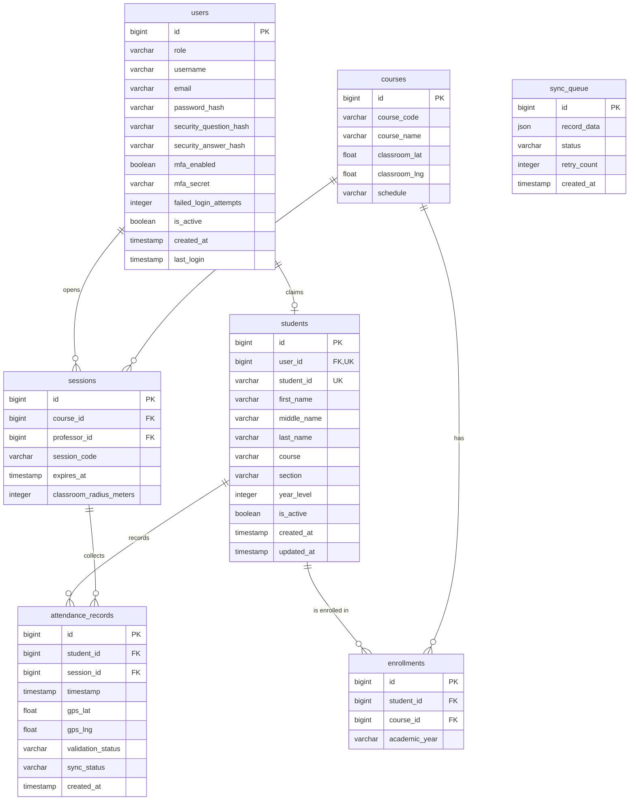

# Database Entity–Relationship Diagram (ERD)

> Crow's-foot notation for the QR-based attendance system.
> Source schema: `docs/proposals/proposal.md` §6.3, extended with a `users`
> table to back `sessions.professor_id`.

## Entities & Attributes

| Table | Attributes |
| ----- | ---------- |
| `users` | id (PK), role (admin/professor/student), username, email, password_hash, security_question_hash, security_answer_hash, mfa_enabled, mfa_secret, failed_login_attempts, is_active, created_at, last_login |
| `students` | id (PK), **user_id (FK → users, UK, nullable — set when the student claims the record at registration)**, **student_id (UK — value encoded in ID-card QR)**, first_name, middle_name, last_name, course, section, year_level, is_active, created_at, updated_at |
| `courses` | id (PK), course_code, course_name, classroom_lat, classroom_lng, schedule |
| `enrollments` | id (PK), student_id (FK → students), course_id (FK → courses), academic_year |
| `sessions` | id (PK), course_id (FK → courses), professor_id (FK → users), session_code, expires_at, classroom_radius_meters |
| `attendance_records` | id (PK), student_id (FK → students), session_id (FK → sessions), timestamp, gps_lat, gps_lng, validation_status, sync_status, created_at |
| `sync_queue` | id (PK), record_data (JSON), status, retry_count, created_at |

## Mermaid (renders on GitHub)

Mermaid's `erDiagram` uses its own notation (not crow's-foot); the ASCII
section below is the canonical crow's-foot representation.



## Crow's-Foot Diagram (canonical)

```
                     ┌───────────────────────────────────────┐
                     │                users                  │
                     │───────────────────────────────────────│
│ id           PK                       │
                      │ role                                 │
                      │ username                             │
                      │ email                                │
                      │ password_hash                        │
                      │ security_question_hash               │
                      │ security_answer_hash                 │
                      │ mfa_enabled                          │
                      │ mfa_secret                           │
                      │ failed_login_attempts                │
                      │ is_active                            │
                      │ created_at                           │
                      │ last_login                           │
  ┬──────────────────└───────────────┬───────────────────────┘
  │                                   │ 1   (professor) opens
  │  (claims) 1                       │
  │  ┌─────────────────────────┐       o<{
  │  │         courses         │       │
  │  │─────────────────────────│       │
  │  │ id                PK    │       │
  │  │ course_code             │       │
  │  │ course_name             │       │
  │  │ classroom_lat           │  ┌────┴───────────────────────┐
  │  │ classroom_lng           │  │          sessions          │
  │  │ schedule                │  │────────────────────────────│
  │  └───────────┬─────────────┘  │ id                   PK    │
  │               │ 1              │ professor_id  FK → users   │
  │               o<{              │ course_id     FK → courses │
  │               │                │ session_code               │
  │  ┌───────────┴─────────────┐  │ expires_at                 │
  │  │       enrollments       │  │ classroom_radius_meters    │
  │  │─────────────────────────│  └──────────┬─────────────────┘
  │  │ id                 PK   │             │ 1  (collects)
  │  │ student_id  FK          │             o<{────────────┐
  │  │ course_id   FK          │             │              │
  │  │ academic_year           │  ┌──────────┴───────────────┴───────────────┐
  │  └───────────┬─────────────┘  │──────────────────────────────────────────│
  │               │ 1              │ id                   PK                 │
  │  ┌────────────┴─────────────┐  │ student_id  FK → students               │
  │         students         │  │ session_id  FK → sessions               │
  │──────────────────────────│  │ timestamp                                │
  │ user_id   FK → users     │  │ gps_lat, gps_lng                         │
  │ id                PK     │  │ validation_status (valid/pending/reject)│
  │ student_id       UK ← QR │  │ sync_status (synced/pending/fail)       │
  │ first_name               │
  │ middle_name              │
  │ last_name                │
  │ course, section          │
  │ year_level               │  └────────────────────┬────────────────────┘
  │ is_active                │                       │ (offline queue — no FK)
  │ created_at, updated_at   │                       ○
  └───────────────┬──────────┘             ┌──────────┴─────────────┐
                  │ 1                      │       sync_queue       │
                  o<{                      │────────────────────────│
                  │                        │ id            PK       │
                  │                        │ record_data   JSON     │
                  │                        │ status                 │
                  │                        │ retry_count            │
                  │                        │ created_at             │
                  │                        └────────────────────────┘
```

## Cardinality (crow's foot)

`‖` = exactly one (mandatory), `○` = zero (optional), `⟨`/`{` = many.

| Parent (1) | Crow's foot | Child (many) | Cardinality |
| ---------- | ----------- | ------------ | ----------- |
| `users` | `‖──○{` | `sessions` | one user *(professor)* opens many |
| `users` | `‖──○|` | `students` | one user claims zero-or-one student *(set at registration)* |
| `courses` | `‖──○{` | `sessions` | one course hosts many |
| `courses` | `‖──○{` | `enrollments` | one course has many enrollments |
| `students` | `‖──○{` | `enrollments` | one student has many enrollments |
| `students` | `‖──○{` | `attendance_records` | one student has many records |
| `sessions` | `‖──○{` | `attendance_records` | one session has many records |

> **Note:** `attendance_records → sync_queue` is an **offline queue**, not a
> relational child. `sync_queue.record_data` stores a serialized attendance
> record as JSON; it is written by the client's offline worker and has no
> enforced foreign key to `attendance_records`.