# Database Entity–Relationship Diagram (ERD)

> Crow's-foot notation for the QR-based attendance system — **Target Schema** (per DOCS_REFACTOR_PLAN §6).
> Source: `docs/project/migration-strategy.md` steps 1–9.
> New tables: `programs`, `year_levels`, `course_offerings`, `course_professors`, `excuse_requests`, `student_risk_scores`, `backup_log`.

---

## Entities & Attributes

| Table                 | Attributes                                                                                                                                                                                                                                                                                                                                                                                                                                                                                         |
| --------------------- | -------------------------------------------------------------------------------------------------------------------------------------------------------------------------------------------------------------------------------------------------------------------------------------------------------------------------------------------------------------------------------------------------------------------------------------------------------------------------------------------------- |
| `users`               | id (PK), role (super_admin/admin/professor/student), username, email, password_hash (Argon2id), security_question_hash, security_answer_hash, mfa_enabled, mfa_secret, failed_login_attempts, must_change_password, is_active, created_at, last_login                                                                                                                                                                                                                                                |
| `otp_codes`           | id (PK), email (index), purpose (claim/forget_password), otp_hash (Argon2id), expires_at (5-min TTL), consumed_at (single-use), user_id (FK → users, nullable), created_at                                                                                                                                                                                                                                                                                                                           |
| `programs`            | id (PK), code (UK), name, description, total_years, is_active, created_at, updated_at                                                                                                                                                                                                                                                                                                                                                                                                              |
| `year_levels`         | id (PK), program_id (FK → programs CASCADE), year_number, label, term_structure (JSONB), sort_order, UNIQUE(program_id, year_number)                                                                                                                                                                                                                                                                                                                                                               |
| `courses`             | id (PK), course_code (UK), course_name, units, session_duration_hours (NUMERIC(3,1)), is_active, created_at, updated_at                                                                                                                                                                                                                                                                                                                                                                              |
| `course_offerings`    | id (PK), course_id (FK → courses RESTRICT), program_id (FK → programs RESTRICT), year_level_id (FK → year_levels RESTRICT), semester (String 20: '1st_sem'/'2nd_sem'/'midyear'), academic_year (String 20), sessions_per_week, semester_weeks, schedule_days (String 10: 'MWF'), schedule_start_time (TIME), schedule_end_time (TIME), classroom_name (String 100), classroom_lat, classroom_lng, default_present_window_minutes (DEF 5), default_late_window_minutes (DEF 10), is_active, created_at, updated_at, UNIQUE(course_id, program_id, semester, academic_year) |
| `course_professors`   | offering_id (FK → course_offerings CASCADE), professor_id (FK → professors CASCADE), is_primary (BOOL), effective_from (DATE), effective_to (DATE NULL), semester, assigned_by (FK → users), assigned_at, PK(offering_id, professor_id, effective_from)                                                                                                                                                                                                                                                         |
| `students`            | id (PK), user_id (FK → users, UK, nullable), student_id (UK), email (UK), first_name, middle_name, last_name, year_level (INT, retained), section (retained per D2), is_active, face_embedding (BYTEA NULL), face_enrolled_at (TIMESTAMPTZ NULL), face_embedding_version (INT DEF 0), created_at, updated_at — **legacy `course` string dropped**                                                                                                                                                  |
| `professors`          | id (PK), user_id (FK → users, UK, nullable), email (UK), first_name, middle_name, last_name, department, is_active, created_at, updated_at                                                                                                                                                                                                                                                                                                                                                         |
| `enrollments`         | id (PK), student_id (FK → students), offering_id (FK → course_offerings), academic_year, semester (validated against year_level.term_structure), UNIQUE(student_id, offering_id, academic_year)                                                                                                                                                                                                                                                                                                             |
| `sessions`            | id (PK), offering_id (FK → course_offerings), professor_id (FK → professors), session_code (UK), duration_minutes, present_window_minutes, late_window_minutes, CHECK (present_window_minutes + late_window_minutes <= duration_minutes), scheduled_start_time (TIMESTAMPTZ), scheduled_end_time (TIMESTAMPTZ), expires_at (TIMESTAMPTZ, STORED: LEAST(created_at + duration_minutes * interval '1 min', scheduled_end_time)), classroom_radius_meters, classroom_name (NULL), classroom_lat (NULL), classroom_lng (NULL), created_at |
| `attendance_records`  | id (PK), student_id (FK → students), session_id (FK → sessions), timestamp, gps_lat, gps_lng, validation_status (present/late/absent/excused/pending/rejected), sync_status, liveness_evidence (JSONB), face_match_score (NUMERIC(5,4)), scanned_via (qr_camera/manual_code), original_status (NULL), excuse_reason (NULL), excused_by (FK → users NULL), excused_at (NULL), excuse_type (quick/prof_with_evidence/request_approved NULL), excuse_request_id (FK NULL), created_at                 |
| `excuse_requests`     | id (PK), student_id (FK), session_id (FK), initiated_by (professor/student), initiated_via (quick/prof_with_evidence/request), reason, attachment_urls (JSONB), status (pending/approved/rejected DEF pending), requested_at, reviewed_by (FK → users NULL), reviewed_at (NULL), review_notes (NULL)                                                                                                                                                                                               |
| `student_risk_scores` | id (PK), student_id (FK → students), offering_id (FK → course_offerings), semester, risk_probability (NUMERIC(5,4)), risk_level (low/medium/high), features (JSONB), computed_at, UNIQUE(student_id, offering_id, semester, computed_at::date)                                                                                                                                                                                                                                                                   |
| `backup_log`          | id (PK), filename, kind (full/analytics), size_bytes (BIGINT), sha256, storage_backend (local/s3), encryption_key_version, started_at, finished_at, status, error (NULL)                                                                                                                                                                                                                                                                                                                           |
| `sync_queue`          | id (PK), record_data (JSON), status, retry_count, created_at                                                                                                                                                                                                                                                                                                                                                                                                                                       |

---

## Mermaid (renders on GitHub)

```mermaid
erDiagram
    users ||--o{ otp_codes : "receives"
    users ||--o| students : "claims"
    users ||--o| professors : "claims"
    professors ||--o{ sessions : "opens"
    users ||--o{ course_professors : "assigns"
    users ||--o{ excuse_requests : "reviews (excused_by/reviewed_by)"
    users ||--o{ attendance_records : "excuses"
    users ||--o{ backup_log : "initiates"
    programs ||--o{ year_levels : "owns"
    programs ||--o{ course_offerings : "offers"
    year_levels ||--o{ course_offerings : "contains"
    courses ||--o{ course_offerings : "template for"
    course_offerings ||--o{ course_professors : "assigned"
    professors ||--o{ course_professors : "teaches"
    course_offerings ||--o{ sessions : "hosts"
    course_offerings ||--o{ enrollments : "has"
    course_offerings ||--o{ student_risk_scores : "evaluates"
    students ||--o{ enrollments : "takes"
    students ||--o{ attendance_records : "records"
    students ||--o{ excuse_requests : "subject of"
    students ||--o{ student_risk_scores : "scored"
    sessions ||--o{ attendance_records : "collects"
    sessions ||--o{ excuse_requests : "for session"
    excuse_requests ||--o{ attendance_records : "originates"
    course_professors ||--o{ sessions : "professor of record (via effective range)"

    users {
        bigint id PK
        varchar role
        varchar username
        varchar email
        varchar password_hash
        varchar security_question_hash
        varchar security_answer_hash
        boolean mfa_enabled
        varchar mfa_secret
        integer failed_login_attempts
        boolean must_change_password
        boolean is_active
        timestamp created_at
        timestamp last_login
    }
    otp_codes {
        bigint id PK
        varchar email
        varchar purpose
        varchar otp_hash
        timestamp expires_at
        timestamp consumed_at
        bigint user_id FK
        timestamp created_at
    }
    programs {
        bigint id PK
        varchar code UK
        varchar name
        text description
        integer total_years
        boolean is_active
        timestamp created_at
        timestamp updated_at
    }
    year_levels {
        bigint id PK
        bigint program_id FK
        integer year_number
        varchar label
        jsonb term_structure
        integer sort_order
    }
    courses {
        bigint id PK
        varchar course_code UK
        varchar course_name
        integer units
        numeric session_duration_hours
        boolean is_active
        timestamp created_at
        timestamp updated_at
    }
    course_offerings {
        bigint id PK
        bigint course_id FK
        bigint program_id FK
        bigint year_level_id FK
        varchar semester
        varchar academic_year
        integer sessions_per_week
        integer semester_weeks
        varchar schedule_days
        time schedule_start_time
        time schedule_end_time
        varchar classroom_name
        float classroom_lat
        float classroom_lng
        integer default_present_window_minutes
        integer default_late_window_minutes
        boolean is_active
        timestamp created_at
        timestamp updated_at
    }
    course_professors {
        bigint offering_id FK
        bigint professor_id FK
        boolean is_primary
        date effective_from
        date effective_to
        varchar semester
        bigint assigned_by FK
        timestamp assigned_at
    }
    students {
        bigint id PK
        bigint user_id UK
        varchar student_id UK
        varchar email UK
        varchar first_name
        varchar middle_name
        varchar last_name
        integer year_level
        varchar section
        boolean is_active
        bytea face_embedding
        timestamp face_enrolled_at
        integer face_embedding_version
        timestamp created_at
        timestamp updated_at
    }
    professors {
        bigint id PK
        bigint user_id UK
        varchar email UK
        varchar first_name
        varchar middle_name
        varchar last_name
        varchar department
        boolean is_active
        timestamp created_at
        timestamp updated_at
    }
    enrollments {
        bigint id PK
        bigint student_id FK
        bigint offering_id FK
        varchar academic_year
        varchar semester
    }
    sessions {
        bigint id PK
        bigint offering_id FK
        bigint professor_id FK
        varchar session_code UK
        integer duration_minutes
        integer present_window_minutes
        integer late_window_minutes
        timestamp scheduled_start_time
        timestamp scheduled_end_time
        timestamp expires_at
        integer classroom_radius_meters
        varchar classroom_name
        float classroom_lat
        float classroom_lng
        timestamp created_at
    }
    attendance_records {
        bigint id PK
        bigint student_id FK
        bigint session_id FK
        timestamp timestamp
        float gps_lat
        float gps_lng
        varchar validation_status
        varchar sync_status
        jsonb liveness_evidence
        numeric face_match_score
        varchar scanned_via
        varchar original_status
        text excuse_reason
        bigint excused_by FK
        timestamp excused_at
        varchar excuse_type
        bigint excuse_request_id FK
        timestamp created_at
    }
    excuse_requests {
        bigint id PK
        bigint student_id FK
        bigint session_id FK
        varchar initiated_by
        varchar initiated_via
        text reason
        jsonb attachment_urls
        varchar status
        timestamp requested_at
        bigint reviewed_by FK
        timestamp reviewed_at
        text review_notes
    }
    student_risk_scores {
        bigint id PK
        bigint student_id FK
        bigint offering_id FK
        varchar semester
        numeric risk_probability
        varchar risk_level
        jsonb features
        timestamp computed_at
    }
    backup_log {
        bigint id PK
        varchar filename
        varchar kind
        bigint size_bytes
        varchar sha256
        varchar storage_backend
        integer encryption_key_version
        timestamp started_at
        timestamp finished_at
        varchar status
        text error
    }
    sync_queue {
        bigint id PK
        json record_data
        varchar status
        integer retry_count
        timestamp created_at
    }
```



---

## Crow's-Foot Diagram (canonical)

```
                      ┌──────────────────────────────────────────────────────────────┐
                      │                             users                             │
                      │──────────────────────────────────────────────────────────────│
                      │ id                              PK                           │
                      │ role (super_admin/admin/professor/student)                   │
                      │ username, email, password_hash (Argon2id)                    │
                      │ security_question_hash, security_answer_hash                 │
                      │ mfa_enabled, mfa_secret, failed_login_attempts               │
                      │ must_change_password, is_active, created_at, last_login      │
   ┬──────────────────┼───────────────────────────┬──────────────────────────────────┘
   │                  │                           │
   │  (claims) 1      │  (claims) 1               │  (opens) 1
   │  ┌───────────────┴────────────────────┐      │
   │  │              students              │      o<{
   │  │────────────────────────────────────│      │
   │  │ id                        PK       │      │
   │  │ user_id    FK → users (UK)        │      │  ┌───────────────────────────────────────┐
   │  │ student_id UK, email UK           │      │  │               sessions                 │
   │  │ first_name, middle_name, last_name│      │  │───────────────────────────────────────│
   │  │ year_level, section, is_active    │      │  │ id                        PK           │
   │  │ face_embedding BYTEA,             │      │  │ offering_id FK → course_offerings      │
   │  │   face_enrolled_at                │      │  │ professor_id  FK → professors           │
   │  │ face_embedding_version            │      │  │ session_code  UK                       │
   │  │ created_at, updated_at            │      │  │ duration_minutes                        │
   │  └───────────────┬───────────────────┘      │  │ present_window_minutes                 │
   │                  │ 1                        │  │ late_window_minutes                    │
   │                  o<{                        │  │ CHECK(present+late <= duration)        │
   │  ┌───────────────┴───────────────────┐      │  │ scheduled_start_time                   │
   │  │             enrollments            │      │  │ scheduled_end_time                     │
   │  │────────────────────────────────────│      │  │ expires_at (STORED)                    │
   │  │ id                        PK       │      │  │   = LEAST(created_at + duration,       │
   │  │ student_id FK → students          │      │  │          scheduled_end_time)           │
   │  │ offering_id FK → course_offerings │      │  │ classroom_radius_meters                │
   │  │ academic_year                     │      │  │ classroom_name/lat/lng (NULL override) │
   │  │ semester (term_structure)         │      │  │ created_at                             │
   │  │ UNIQUE(student_id, offering_id,   │      │  └─────────────────┬─────────────────────┘
   │  │   academic_year)                  │      │                    │ 1 (collects)
   │  └───────────────┬───────────────────┘      │                    o<{
   │                  │ 1                        │  ┌─────────────────┴───────────────────────────────────────┐
   │  ┌───────────────┴───────────────────┐      │  │               attendance_records                        │
   │  │           course_offerings         │      │  │───────────────────────────────────────────────────────│
   │  │────────────────────────────────────│      │  │ id PK, student_id FK → students                       │
   │  │ id                        PK       │      │  │ session_id FK → sessions                               │
   │  │ course_id    FK → courses         │      │  │ timestamp, gps_lat, gps_lng                            │
   │  │ program_id   FK → programs        │      │  │ validation_status (present/late/absent/                │
   │  │ year_level_id FK → year_levels    │      │  │   excused/pending/rejected)                            │
   │  │   (all three RESTRICT)            │      │  │ sync_status                                            │
   │  │ semester ('1st_sem'/'2nd_sem'/    │      │  │ liveness_evidence JSONB                                 │
   │  │   'midyear')                      │      │  │ face_match_score NUMERIC(5,4)                           │
   │  │ academic_year                     │      │  │ scanned_via (qr_camera/manual_code)                      │
   │  │ sessions_per_week, semester_weeks │      │  │ original_status, excuse_reason, excused_by,             │
   │  │ schedule_days ('MWF' String 10)   │      │  │   excused_at, excuse_type, excuse_request_id            │
   │  │ schedule_start_time/end_time TIME │      │  │ created_at                                             │
   │  │ classroom_name (String 100)       │      │  └───────────────────────────────┬────────────────────────┘
   │  │ classroom_lat, classroom_lng      │      │                                  │
   │  │ default_present_window_minutes (5)│      │                                  │ (excuse_requests links
   │  │ default_late_window_minutes (10)  │      │                                  │  session + student)
   │  │ is_active, created_at, updated_at │      │                                  ○
   │  │ UNIQUE(course_id, program_id,     │      │  ┌───────────────────────────────┴────────────────────────┐
   │  │   semester, academic_year)        │      │  │                    excuse_requests                      │
   │  └───────────────┬───────────────────┘      │  │───────────────────────────────────────────────────────│
   │                  │ 1 (templates)            │  │ id PK, student_id FK, session_id FK                    │
   │                  o<{                        │  │ initiated_by (professor/student)                        │
   │  ┌───────────────┴───────────────────┐      │  │ initiated_via (quick/prof_with_evidence/request)        │
   │  │ courses (pure template)            │      │  │ reason, attachment_urls JSONB                           │
   │  │────────────────────────────────────│      │  │ status (pending/approved/rejected DEF pending)         │
   │  │ id                        PK       │      │  │ requested_at, reviewed_by FK (NULL)                    │
   │  │ course_code                UK      │      │  │ reviewed_at (NULL), review_notes (NULL)                │
   │  │ course_name                        │      │  └───────────────────────────────────────────────────────┘
   │  │ units                              │      │
   │  │ session_duration_hours NUMERIC(3,1)│      │
   │  │ is_active, created_at, updated_at  │      │
   │  └───────────────┬───────────────────┘      │
   │                  │ 1 (offering parents)     │
   │                  o<{                        │
   │  ┌───────────────┴───────────────────┐      │
   │  │             programs               │      │
   │  │────────────────────────────────────│      │
   │  │ id PK, code UK, name               │      │
   │  │ description, total_years           │      │
   │  │ is_active, created_at, updated_at  │      │
   │  └───────────────┬───────────────────┘      │
   │                  │ 1 (owns)                  │
   │                  o<{                        │
   │  ┌───────────────┴───────────────────┐      │
   │  │            year_levels             │      │
   │  │────────────────────────────────────│      │
   │  │ id PK, program_id FK → programs   │      │
   │  │ year_number, label, sort_order    │      │
   │  │ term_structure JSONB              │      │
   │  │ UNIQUE(program_id, year_number)   │      │
   │  └────────────────────────────────────┘      │
   │                                              │
   │  ┌───────────────────────────────────────────┐
   │  │   course_professors (offering-scoped)     │
   │  │───────────────────────────────────────────│
   │  │ offering_id FK → course_offerings (CASCADE)│
   │  │ professor_id FK → professors (CASCADE)     │
   │  │ is_primary, effective_from DATE            │
   │  │ effective_to DATE (NULL = ongoing)         │
   │  │ semester, assigned_by FK → users           │
   │  │ assigned_at                                │
   │  │ PK(offering_id, professor_id, effective_from)│
   │  └───────────────────────────────────────────┘
   │
   │  ┌───────────────────────────────────────────┐
   │  │                 professors                │
   │  │───────────────────────────────────────────│
   │  │ id PK, user_id FK → users (UK)            │
   │  │ email UK, first/middle/last_name           │
   │  │ department, is_active                      │
   │  │ created_at, updated_at                     │
   │  └───────────────────────────────────────────┘
   │
   │  ┌───────────────────────────────────────────┐
   │  │           student_risk_scores             │
   │  │───────────────────────────────────────────│
   │  │ id PK                                     │
   │  │ student_id FK → students                  │
   │  │ offering_id FK → course_offerings         │
   │  │ semester                                  │
   │  │ risk_probability NUMERIC(5,4)             │
   │  │ risk_level (low/medium/high)              │
   │  │ features JSONB, computed_at               │
   │  │ UNIQUE(student_id, offering_id,           │
   │  │   semester, computed_at::date)            │
   │  └───────────────────────────────────────────┘
   │
   │  ┌───────────────────────────────────────────┐
   │  │                 backup_log                │
   │  │───────────────────────────────────────────│
   │  │ id PK, filename, kind (full/analytics)    │
   │  │ size_bytes BIGINT, sha256                 │
   │  │ storage_backend (local/s3)                │
   │  │ encryption_key_version                    │
   │  │ started_at, finished_at                   │
   │  │ status, error (NULL)                      │
   │  └───────────────────────────────────────────┘
   │
   │  ┌───────────────────────────────────────────┐
   │  │        sync_queue (offline queue)         │
   │  │───────────────────────────────────────────│
   │  │ id PK, record_data JSON, status           │
   │  │ retry_count, created_at                   │
   │  └───────────────────────────────────────────┘
   │
   │  ┌───────────────────────────────────────────┐
   │  │                otp_codes                  │
   │  │───────────────────────────────────────────│
   │  │ id PK, email (index)                      │
   │  │ purpose claim/forget_password             │
   │  │ otp_hash (Argon2id)                       │
   │  │ expires_at (5-min), consumed_at (1-use)   │
   │  │ user_id FK → users (nullable)             │
   │  │ created_at                                │
   │  └───────────────────────────────────────────┘
```

---

## Cardinality (crow's foot)

`‖` = exactly one (mandatory), `○` = zero (optional), `⟨`/`{` = many.

| Parent (1)          | Crow's foot | Child (many)          | Cardinality                                                                                                     |
| ------------------- | ----------- | --------------------- | --------------------------------------------------------------------------------------------------------------- |
| `users`             | `‖──○{`     | `otp_codes`           | one user receives many OTP codes _(or email-only before account exists)_                                        |
| `professors`        | `‖──○{`     | `sessions`            | one professor opens many                                                                                         |
| `users`             | `‖──○       | `                     | `students`                                                                                                      | one user claims zero-or-one student _(set at registration)_   |
| `users`             | `‖──○       | `                     | `professors`                                                                                                    | one user claims zero-or-one professor _(set at registration)_ |
| `users`             | `‖──○{`     | `excuse_requests`     | one user reviews many (as `excused_by`/`reviewed_by`)                                                           |
| `users`             | `‖──○{`     | `backup_log`          | one user initiates many backups                                                                                 |
| `programs`          | `‖──○{`     | `year_levels`         | one program owns many year levels (CASCADE)                                                                     |
| `programs`          | `‖──○{`     | `course_offerings`    | one program offers many course offerings (RESTRICT)                                                             |
| `year_levels`       | `‖──○{`     | `course_offerings`    | one year level contains many course offerings (RESTRICT)                                                        |
| `year_levels`       | `‖──○{`     | `students`            | one year level has many students                                                                                |
| `courses`           | `‖──○{`     | `course_offerings`    | one course templates many offerings (per program/year/semester)                                                 |
| `course_offerings`  | `‖──○{`     | `course_professors`   | one offering has many professor assignments                                                                     |
| `professors`        | `‖──○{`     | `course_professors`   | one professor teaches many offerings                                                                            |
| `course_offerings`  | `‖──○{`     | `sessions`            | one offering hosts many sessions                                                                                |
| `course_offerings`  | `‖──○{`     | `enrollments`         | one offering has many enrollments                                                                               |
| `course_offerings`  | `‖──○{`     | `student_risk_scores` | one offering has many risk scores                                                                               |
| `students`          | `‖──○{`     | `enrollments`         | one student has many enrollments                                                                                |
| `students`          | `‖──○{`     | `attendance_records`  | one student has many records                                                                                    |
| `students`          | `‖──○{`     | `excuse_requests`     | one student has many excuse requests                                                                            |
| `students`          | `‖──○{`     | `student_risk_scores` | one student has many risk scores                                                                                |
| `sessions`          | `‖──○{`     | `attendance_records`  | one session has many records                                                                                    |
| `sessions`          | `‖──○{`     | `excuse_requests`     | one session has many excuse requests                                                                            |
| `course_professors` | `‖──○{`     | `sessions`            | one assignment covers many sessions _(professor of record determined by effective range at session.created_at)_ |

> **Notes:**
>
> - `attendance_records → sync_queue` is an **offline queue**, not a relational child. `sync_queue.record_data` stores a serialized attendance record as JSON; written by client's offline worker; no enforced FK.
> - `course_professors` uses **effectiveness dating** (D7/D8): a session's professor of record is the `course_professors` row where `session.created_at::date BETWEEN effective_from AND COALESCE(effective_to, 'infinity')` AND `semester` matches.
> - `students.face_embedding` stores encrypted JSON blob: `{"mean":[128f],"angles":{"front":[...],"left":[...],"right":[...]}}` (D28/D43).
> - `year_levels.term_structure` JSONB: `{"terms":[{"code":"1st_sem","label":"1st Semester"},...]}` (D3).
> - `sessions.expires_at` is a **STORED generated column**: `LEAST(created_at + duration_minutes * interval '1 minute', scheduled_end_time)` (D12).
> - `ValidationStatus` enum: `present` · `late` · `absent` · `excused` · `pending` · `rejected` (D15).
> - Rejection reasons: `duplicate` · `outside_geofence` · `liveness_failed` · `face_mismatch` · `not_enrolled` · `session_expired` (D15/D16).

