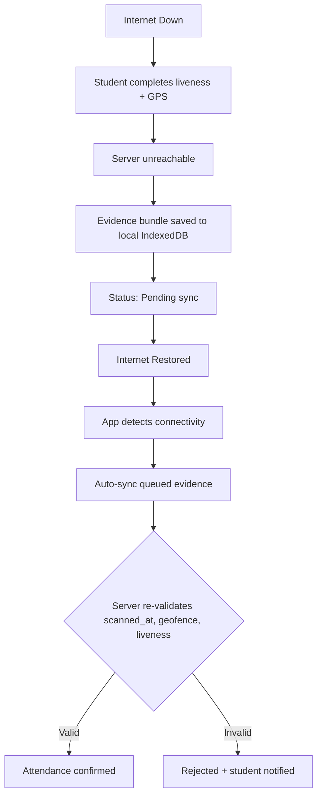
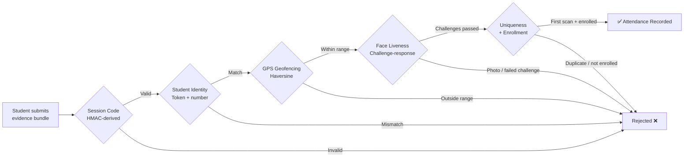

# QR-Code Based Offline-Capable Attendance System with Anti-Spoofing

> **Status (2026-10-24):** this is the original proposal deck. The shipped flow
> derives student identity from the signed-in account (no student-ID QR), and
> face matching against an enrolled embedding is not implemented. The slides
> below have been corrected where they described those as current behavior.

**Presenters:** Allan Acosta · Kharl Bugarin · Luigi Navero

**Course & Section:** `BSCS 3`

**Subject:** `Software Engineering 1`

---

## Introduction

**What is this project?**

An attendance system that replaces manual roll call with a professor-issued session code, a signed-in student account, GPS geofencing, and a face-liveness check. Students confirm their student ID from their profile — no ID-card QR scan is required.

**Why is it important?**

- Manual attendance wastes **5–10 minutes** of every class
- Professors lose valuable lecture time
- Paper records are easily lost or damaged

**Purpose of the system:**

- Automate attendance recording
- Prevent fraudulent submissions
- Work reliably even without internet

---

## Problem Statement

**The Real-World Problem**

- **Slow process** — Calling names one by one takes too long
- **Fraud** — Students sign for absent classmates or share session codes
- **Unreliable internet** — Campus connectivity is not always stable
- **Lost records** — Paper sheets get misplaced

**Who is affected?**

| Person             | Impact                                    |
| ------------------ | ----------------------------------------- |
| **Professors**     | Lost lecture time, inaccurate records     |
| **Students**       | Unfair attendance marking, wasted time    |
| **Administrators** | No reliable attendance data for reporting |

---

## Project Description

**What the system does**

A Progressive Web Application (PWA) that:

1. Verifies the session code shown by the professor
2. Resolves the student from their signed-in account and confirms the student number
3. Validates attendance through **multi-layer anti-spoofing**
4. Works **offline** by storing evidence locally and auto-syncing later
5. Provides **dashboards and reports** for professors

**Main Features**

| Feature            | Purpose                                                             |
| ------------------ | ------------------------------------------------------------------- |
| Session Entry      | Professor shares a time-limited code; a QR payload exists but is not rendered yet |
| Student ID Check   | Prefilled number confirmed against the signed-in account            |
| GPS Verification   | Ensures student is in the classroom                                 |
| Face Liveness      | Blink/head-turn evidence raises the cost of photo/replay attacks; face matching is not implemented |
| Offline Mode       | Stores attendance evidence when no internet                         |
| Dashboard          | Real-time attendance view & reports                                 |
| Analytics          | At-risk forecasting + recommendations                               |

**How it solves the problem**

- Eliminates manual roll call → **saves 5–10 min per class**
- Multi-layer validation → **prevents cheating**
- Offline capability → **works anywhere, anytime**

---

## Target Users

| User               | Role                                                           |
| ------------------ | -------------------------------------------------------------- |
| **Professors**     | Open sessions, view real-time attendance, generate reports     |
| **Students**       | Sign in, enter the session code, confirm student number, complete liveness — no app install needed |
| **Administrators** | Import rosters from CSV, manage courses, export reports        |

---

## System Flow

### Main Attendance Flow

```mermaid
sequenceDiagram
    actor Professor
    actor Student
    participant Server

    Professor->>Server: Login
    Professor->>Server: Select course
    Professor->>Server: Click "Open Session"
    Server->>Server: Generate HMAC-derived code
    Server-->>Professor: Session code
    Professor-->>Student: Code on projector

    Student->>Student: Enter session code
    Student->>Student: Confirm student number (prefilled from account)
    Student->>Student: Complete face-liveness challenge
    Student->>Student: Capture GPS
    Student->>Student: Submit evidence (server computes face match)

    Server->>Server: 1. Verify session code + expiry
    Server->>Server: 2. Resolve student from token; compare student_number
    Server->>Server: 3. Check enrollment + duplicate scan
    Server->>Server: 4. Validate GPS geofence (Haversine)
    Server->>Server: 5. Grade liveness evidence + score band (no embedding match)

    alt All checks pass
        Server-->>Student: ✅ Attendance recorded
        Server-->>Professor: Student appears present
    else Any check fails
        Server-->>Student: ❌ Attendance rejected with reason
    end
```

### Offline Mode



### Anti-Spoofing Layers



### Input → Process → Output

| Input               | Process                    | Output                       |
| ------------------- | -------------------------- | ---------------------------- |
| Student number      | Compared to authenticated account | Identity confirmed     |
| GPS coordinates     | Haversine distance formula | Location verified ✅/❌      |
| Session code        | HMAC verification          | Session valid ✅/❌          |
| All inputs combined | Multi-layer validation     | Attendance recorded/rejected |

---

## CS Contribution

**How we contribute on top of existing models/APIs**

| Layer          | Borrowed model            | Our contribution                                                                                           |
| -------------- | ------------------------- | ---------------------------------------------------------------------------------------------------------- |
| QR decoding    | `html5-qrcode`            | Session binding + one-scan-per-session duplicate rejection (D15 `duplicate_scan`)  |
| Face liveness  | MediaPipe landmarks       | Fixed challenge sequence (blink → left → right); EAR + head-pose evidence is re-checked server-side. No embedding comparison. |
| Offline safety | —                         | **Offline evidence protocol**: IndexedDB queue, idempotency keys, deferred server re-validation            |
| Decision logic | —                         | **Per-scan checks** (session, identity, duplicate, geofence, liveness, enrollment) + nightly batch risk scoring |
| Risk analytics | — (heuristic rule engine) | At-risk detection (absence rate, streak, sync lag, trend) adapted to sparse, sync-gapped data              |
| Verification   | —                         | Empirical PAD evaluation (proposed): self-built attack corpus, APCER/BPCER metrics                         |

**Attack parameters we defend against:** casual photo/replay · geofence bypass · offline replay · duplicate submission. Face matching and identical-twin detection are **not implemented**.

**Data analysis levels:** descriptive (what happened) · diagnostic (why) · predictive (what's next) · prescriptive (what to do)

---

## Conclusion

**Summary**

This project proposes a QR-based attendance system that:

- Automates the entire attendance process
- Prevents fraud through signed-in identity, session codes, GPS, and face liveness
- Extends anti-spoofing to offline environments via deferred evidence validation
- Provides predictive-prescriptive attendance analytics
- Works with or without internet
- Uses existing phones and browsers — no new hardware needed

**Expected Benefits**

| Benefit     | Impact                                  |
| ----------- | --------------------------------------- |
| Speed       | Scan-to-confirm: p50 < 6s, p95 < 8s (target per benchmarking) |
| Accuracy    | Blocks casual photo/replay and geofence bypass; face matching and identical-twin detection are not implemented |
| Convenience | No app to install, works in any browser |
| Reliability | Works even when internet is down        |

**Why it should be developed**

Manual attendance is a daily problem in every classroom. This system solves it using resources already available (students' phones and browsers) with modern anti-spoofing techniques — saving time, preventing fraud, and providing reliable data for the entire institution.

---

### Thank You

**Questions?**

---

_Presented for Software Engineering 1 · BSCS 3
