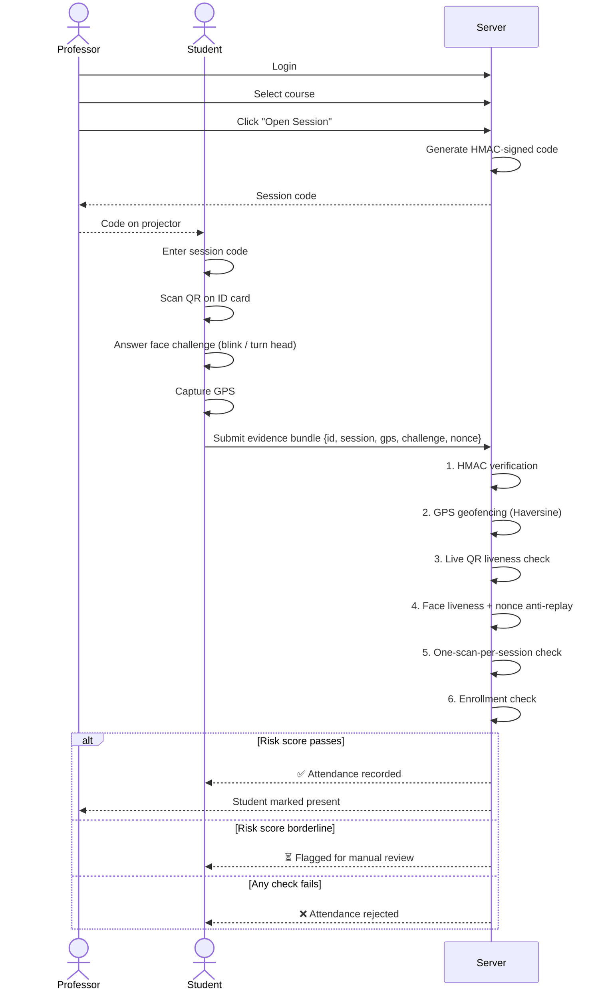
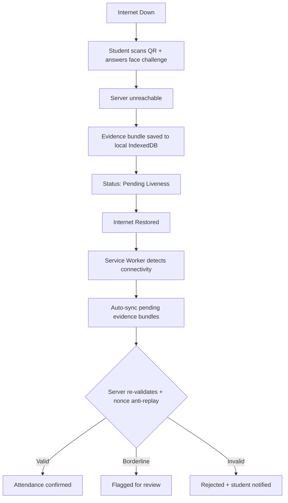
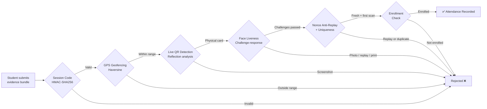

# QR-Code Based Offline-Capable Attendance System with Anti-Spoofing

**Presenters:** Allan Acosta · Kharl Bugarin · Luigi Navero

**Course & Section:** `BSCS 3`

**Subject:** `Software Engineering 1`

---

## Introduction

**What is this project?**

An attendance system that uses the QR codes already printed on student ID cards. Instead of manual roll call, students scan their ID card QR using their phone — attendance is recorded instantly.

**Why is it important?**

- Manual attendance wastes **5–10 minutes** of every class
- Professors lose valuable lecture time
- Paper records are easily lost or damaged

**Purpose of the system:**

- Automate attendance recording
- Prevent fraudulent submissions
- Work reliably even without internet

---

## Problem Statement

**The Real-World Problem**

- **Slow process** — Calling names one by one takes too long
- **Fraud** — Students sign for absent classmates or share QR photos
- **Unreliable internet** — Campus connectivity is not always stable
- **Lost records** — Paper sheets get misplaced

**Who is affected?**

| Person             | Impact                                    |
| ------------------ | ----------------------------------------- |
| **Professors**     | Lost lecture time, inaccurate records     |
| **Students**       | Unfair attendance marking, wasted time    |
| **Administrators** | No reliable attendance data for reporting |

---

## Project Description

**What the system does**

A Progressive Web Application (PWA) that:

1. Scans the QR code from existing campus ID cards
2. Extracts the student ID number embedded in the QR
3. Validates attendance through **multi-layer anti-spoofing**
4. Works **offline** by storing records locally and auto-syncing later
5. Provides **dashboards and reports** for professors

**Main Features**

| Feature            | Purpose                                                             |
| ------------------ | ------------------------------------------------------------------- |
| QR Scanning        | Decode student ID from ID card QR                                   |
| Session Codes      | Professor shares a time-limited code                                |
| GPS Verification   | Ensures student is in the classroom                                 |
| Liveness Detection | Distinguishes physical card from a photo                            |
| Face Liveness      | Blink/head-turn challenges block photo, replay & distortion attacks |
| Offline Mode       | Stores attendance when no internet                                  |
| Dashboard          | Real-time attendance view & reports                                 |
| Analytics          | At-risk forecasting + recommendations                               |

**How it solves the problem**

- Eliminates manual roll call → **saves 5–10 min per class**
- Multi-layer validation → **prevents cheating**
- Offline capability → **works anywhere, anytime**

---

## Target Users

| User               | Role                                                           |
| ------------------ | -------------------------------------------------------------- |
| **Professors**     | Open sessions, view real-time attendance, generate reports     |
| **Students**       | Scan own ID card QR, mark attendance in seconds, no app needed |
| **Administrators** | Import rosters from CSV, manage courses, export reports        |

---

## System Flow

### Main Attendance Flow

### Offline Mode

### Anti-Spoofing Layers

### Input → Process → Output

| Input               | Process                    | Output                       |
| ------------------- | -------------------------- | ---------------------------- |
| QR code scan        | Decode student ID from QR  | Student identified           |
| GPS coordinates     | Haversine distance formula | Location verified ✅/❌      |
| Session code        | HMAC-SHA256 verification   | Session valid ✅/❌          |
| All inputs combined | Multi-layer validation     | Attendance recorded/rejected |

---

## CS Contribution

**How we contribute on top of existing models/APIs**

| Layer          | Borrowed model            | Our contribution                                                                                           |
| -------------- | ------------------------- | ---------------------------------------------------------------------------------------------------------- |
| QR liveness    | `html5-qrcode` heuristics | Integration into the risk-fusion pipeline                                                                  |
| Face liveness  | MediaPipe landmarks       | Challenge-response protocol: random blink/head-turn challenges, EAR + head-pose scoring                    |
| Offline safety | —                         | **Offline liveness protocol**: HMAC evidence bundles, nonce anti-replay, deferred risk-based re-validation |
| Decision logic | —                         | **Risk-fusion scorer**: weighted layer confidences → accept / flag-for-review / reject                     |
| Data analytics | pandas / scikit-learn     | At-risk forecasting adapted to sparse, sync-gapped data + prescriptive rule engine                         |
| Verification   | —                         | Empirical PAD evaluation: self-built attack corpus, APCER/BPCER metrics                                    |

**Attack parameters we defend against:** image/photo · screen recorder · video replay · distortion · offline replay · identical twins (documented limitation, mitigated via cross-modal fusion)

**Data analysis levels:** descriptive (what happened) · diagnostic (why) · predictive (what's next) · prescriptive (what to do)

---

## Conclusion

**Summary**

This project proposes a QR-based attendance system that:

- Automates the entire attendance process
- Prevents fraud through session codes, GPS, QR liveness, and face liveness
- Extends anti-spoofing to offline environments via deferred evidence validation
- Provides predictive-prescriptive attendance analytics
- Works with or without internet
- Uses existing student ID cards — no new hardware needed

**Expected Benefits**

| Benefit     | Impact                                  |
| ----------- | --------------------------------------- |
| Speed       | Under 1 second per student              |
| Accuracy    | Zero fraudulent entries                 |
| Convenience | No app to install, works in any browser |
| Reliability | Works even when internet is down        |

**Why it should be developed**

Manual attendance is a daily problem in every classroom. This system solves it using resources already available (student ID QR codes) with modern anti-spoofing techniques — saving time, preventing fraud, and providing reliable data for the entire institution.

---

### Thank You

**Questions?**

---

_Presented for Software Engineering 1 · BSCS 3
